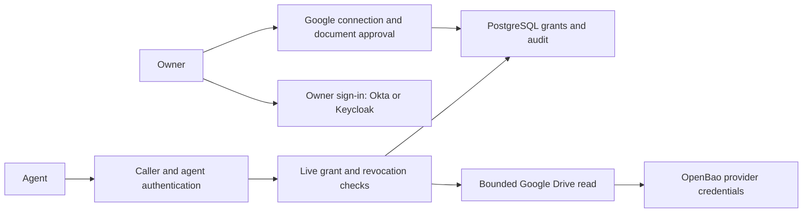

# Toolbox

Toolbox gives agents bounded, user-approved access to external data. Its implemented document operation reads an explicitly approved Google document as plain text. Connecting a Google account does **not** grant an agent access to its documents.

## How it works

An owner signs in, connects a provider account, and approves an exact document for an identified agent and a limited duration. Toolbox checks the grant again when executing the read, so expiry, revocation, and disconnect take effect at the authorization boundary. Provider credentials stay behind the service.



Keycloak optionally brokers Google and Okta login. Google sign-in and authorization to read Google Drive are separate flows. Personal Gmail and Workspace identities can use the Google broker when its configuration allows them. Enterprise domain restrictions are optional policy, not a separate login protocol.

## Supported local modes

| Mode | Behavior |
| --- | --- |
| `fixture` | Synthetic owner and Google data; approval/read/denial/revocation demo without provider accounts. |
| `oidc-local` | Real owner OIDC sign-in with persistent stores; tool operations hidden. |
| `workspace-local` | Owner sign-in, Google consent and Picker, exact-document grants and reads; optional inbound MCP. |

These modes bind to loopback. Public production deployment is not implemented. Native password registration and device mTLS are separate work. The outbound Docker MCP Gateway integration is an isolation pilot, not general GitHub connector onboarding. Automated synthetic tests do not establish every live-provider acceptance case.

## Start developing

Use the Go version declared in [go.mod](go.mod).

```sh
git clone https://github.com/ufaruq/toolbox.git
cd toolbox
make install-hooks
make run
```

Open http://127.0.0.1:8080. Sign in as the fixture owner, connect the simulated Google account, create an agent, approve `doc-A`, read it, then revoke access. A request for `doc-B` must be denied. Use synthetic data: fixture keys and provider state are ephemeral.

`make dev` starts local PostgreSQL/OpenBao and the fixture. For real providers, follow the setup guides below; never commit client secrets.

Run `make help` for the complete command list, including focused tests, browser setup, checks, and dev dependency lifecycle. See the [command reference](docs/development/README.md#make-command-reference).

## Tests and push checks

```sh
make test-all
```

Requires Docker Engine and Compose 2.24.4 or later. It creates isolated disposable stores and runs formatting, vet, race tests, browser flows, real Keycloak and MCP gateway acceptance with controlled identities, and a build. Missing prerequisites and skipped tests fail the gate. Evidence paths are printed at completion. The installed pre-push hook runs the same suite against an archive of the exact commit being pushed. See [development](docs/development/README.md) for prerequisites, focused checks, and enforcement limits.

## Documentation map

- [Parallel agent work](docs/agent-worktrees.md): isolated task worktrees for Codex, Claude, and other agents.

- [GitHub connector](docs/github-connector.md): App installation, scoped grants and MCP repository operations.
- [Architecture](docs/architecture/README.md): components, trust boundaries, request flows, and extension points.
- [Development](docs/development/README.md): local setup, test coverage, push hooks, and documentation conventions.
- [Security](docs/security/README.md): invariants, review expectations, scan limits, and acceptance evidence.
- [Provider and runtime setup](docs/operations/README.md): Okta, Keycloak, Google, MCP, and storage guides.
- [Roadmap](docs/ROADMAP.md): planned work and release gates; verify completion against code and revision-specific evidence.
- [Original design](docs/design/README.md): design rationale and generated diagrams; historical scope may differ from current implementation.
- [Agent instructions](AGENTS.md): concise repository operating rules.

The current architecture lives in the focused READMEs. [Implementation status](docs/implementation-status.md), [handoff](docs/HANDOFF.md), and provider verification reports preserve historical evidence and its limits; they are not a substitute for testing the current revision.
