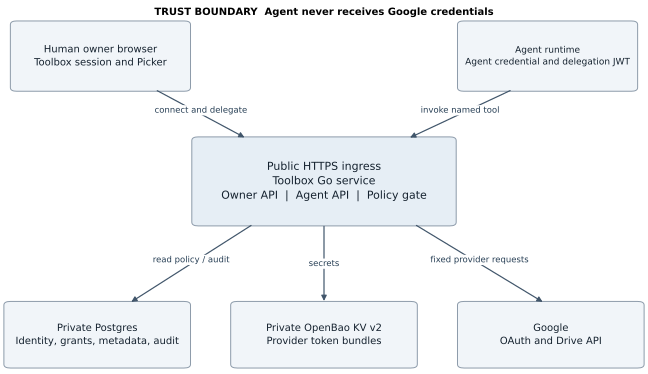
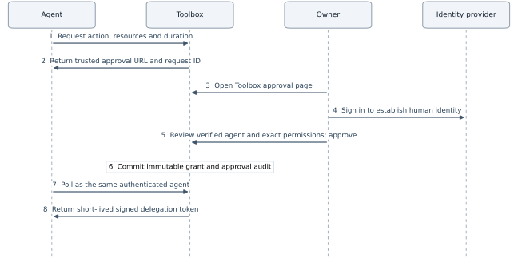
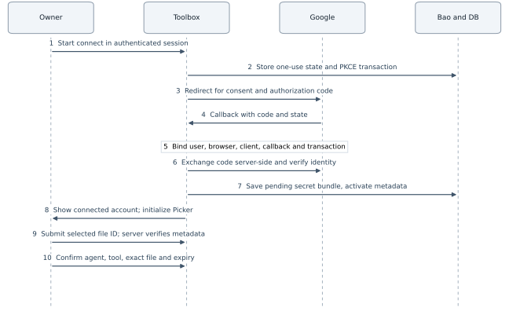
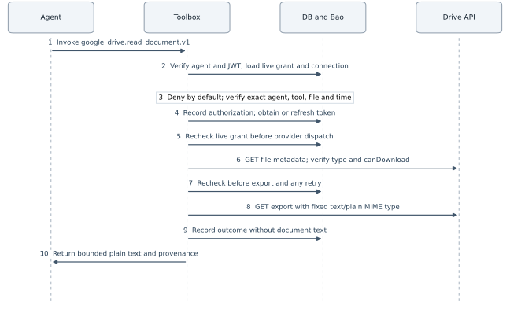
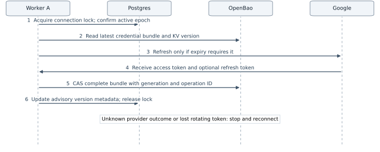

# Toolbox user delegated connections design

[PDF for page-by-page review](user-delegated-connections.pdf) · [Checks already completed](review-checks.md)

Go backend with Google Drive as the first connector

Version 0.1  |  18 October 2026  |  Proposed implementation design

### Decision and first milestone

Build Toolbox as a Go service that holds a user’s Google connection and lets a separately authenticated agent invoke one explicitly delegated tool. The first milestone reads the plain-text export of one Google document that the user selected. A connection alone grants the agent no access.

The initial scope is user-delegated connections, Google Drive and Go. Shared company accounts are a later extension. This document specifies the API, storage, authorization, credential lifecycle, security boundaries and acceptance tests for that first working slice.

| Decision | MVP choice |
| --- | --- |
| Connection ownership | A human Toolbox user owns an OAuth connection to a Google account. |
| Agent identity | A distinct principal with its own Toolbox credential. No Google tokens. |
| Delegation | An agent requests access; the owner approves an explicit grant. Toolbox issues a short-lived scoped JWT bound to that agent. |
| Execution | google_drive.read_document.v1 maps to fixed Drive metadata and export requests. |
| Storage | Postgres for identity, grants, metadata and audit. OpenBao KV v2 for token bundles. |
| Policy | Typed Go checks initially. OPA only when policy complexity justifies another runtime dependency. |

### Security promises

- The agent’s effective authority is the intersection of live Toolbox policy, the user’s Google permission, the OAuth scope and the registered tool implementation.

- No arbitrary URL, HTTP method, provider header, OAuth scope, token or user identity is accepted from the agent.

- Every invocation and provider retry checks current grant and connection state. Revocation blocks newly authorized dispatches; it cannot undo requests already dispatched or erase content already returned.

- Document contents and provider credentials are excluded from application logs, traces and audit records.

The proposed approval flow lets an agent request actions, exact resources and duration, then directs the user to a trusted Toolbox approval page. The identity provider authenticates the person; Toolbox owns the grant and delegation token. Online grant checks retain revocation control without repeating database lookups in every in-process function.

## 1  Architecture and Go boundaries



Figure 1  The owner control plane establishes connections and grants. The agent API can only invoke registered tools.

### Keep one service first

Use one Go binary with explicit packages and two authenticated API surfaces. Start with net/http, context deadlines, a Postgres driver and migrations, golang.org/x/oauth2 for protocol support, and a small Drive client. Pin dependency versions when implementation starts. Token refresh must use the durable token manager described in section 12; a library’s in-memory refresh cache is insufficient across replicas. [S9]

| Package or boundary | Responsibility |
| --- | --- |
| identity and ownerapi | Human session, agent registration, credential issuance, CSRF protection and owner-only management. |
| connections and oauth | OAuth transactions, account binding, connection states and reconnect flow. |
| delegation and policy | Grant validation and a deny-by-default decision from live database facts. |
| tools and connectors/gdrive | Immutable tool name and schema; bounded metadata and export operations. |
| tokens and secrets | Single-flight refresh, distributed coordination, OpenBao access and reconciliation. |
| audit and store | Append-only events, operation outcomes, migrations and ownership-constrained queries. |

The API process is privileged: it can obtain provider secrets. Package boundaries reduce mistakes but do not isolate a compromised process. A separately permissioned token broker or connector worker is a later hardening option, not an MVP requirement.

## 2  Google Drive contract and limits

### Use drive file scope and Google Picker

Request https://www.googleapis.com/auth/drive.file for file access. Google recommends this per-file scope with Picker, and files.export accepts it. It can grant creation and modification capabilities for app-authorized files; it is not a read-only provider token. Toolbox enforces the narrower read-only delegation itself. Do not silently replace it with drive.readonly if selection fails. [S1, S3]

The owner opens Google Picker in the Toolbox web UI with the app’s project number, developer key and an OAuth access token. Use one Google Cloud project and a consistent app identity for the initial implementation. Show Google documents only and verify the returned file server-side; Picker filtering is a convenience, not a security check. [S2]

Browser exception: Picker requires a Google access token in the owner’s browser. That token is used for Picker, but is not cryptographically limited to Picker, the current file or reading. It can cover previously app-authorized files. Keep it only in memory, return it with no-store, never put it in a URL or browser storage, and use its actual provider expiry rather than claiming a shorter provider lifetime. Never send a refresh token to the browser. A browser XSS compromise can steal this token. [S1, S2]

### The first tool reads a native Google document

1. GET https://www.googleapis.com/drive/v3/files/{fileId} with a fixed fields projection: id, name, mimeType, trashed, modifiedTime, capabilities(canDownload). Require the exact allowed ID, not trashed, MIME application/vnd.google-apps.document, and canDownload=true. [S4, S5]

2. GET https://www.googleapis.com/drive/v3/files/{fileId}/export?mimeType=text%2Fplain. No request body. Plain text is a supported Google Docs export format. Ordinary binary files use a different download path and are outside this tool. [S3, S5, S6]

3. Buffer the response with a proposed 1 MiB maximum and a 20-second total invocation deadline. Google’s export API has a separate 10 MB limit. Return an explicit too-large error; never silently truncate or bypass restrictions through another endpoint. [S3]

### Explicit exclusions and edge behavior

Exclude folders, shortcuts, Sheets, Slides, PDFs, arbitrary downloads, writes and shared-drive support from v1. A document shared directly with the connected user may work if Picker authorizes it and Google permits export; it is still that user’s connection, not a company account. A copied document has a new ID and needs a new grant.

Return Google’s current plain-text export, with retrieval time and the observed modifiedTime. Metadata and export are separate calls, so do not claim a revision-pinned snapshot. Comments, suggestions, rich formatting and complete multi-tab fidelity are not promised. Test multi-tab documents in the spike; if full structured coverage is needed, design a separate version using the Docs API rather than overstating v1.

Some link-shared files require a resource key. MVP may reject such a selection with a clear unsupported-resource result. If supported later, persist the verified key privately, bind it to the exact ID and set the fixed Google resource-key header server-side. Never accept an arbitrary caller header. [S12]

## 3  Identity delegation and authorization

### Keep the three relationships separate

A user authenticates to Toolbox using a first-party session backed by a selected OIDC identity provider. An agent is a distinct Toolbox principal. A connection belongs to the user and references the Google account subject that consented. The account used for the connection may differ from the user’s Toolbox sign-in account; the UI must make this explicit.

For the MVP, a user creates and manages their own agents. Agent records have creator_user_id for management, but authentication produces an agent_id, never a user session or an impersonated user. Grants record both the human delegator and agent subject. Later cross-user or organization delegation must add explicit policy rather than infer authority from membership.

### MVP agent authentication

Issue a 256-bit random opaque credential with a non-secret key ID and a secret suffix. Display the secret once; store only a keyed hash, credential ID, agent ID, status, creation and expiry. Verify in constant time over TLS. Use a proposed 30-day credential lifetime, owner-initiated rotation with at most two overlapping active keys, and immediate online revocation checks. The agent credential authenticates the caller; a separate short-lived delegation JWT carries the approved permissions and references the live grant.

Production alternatives include short-lived workload identity, client assertions or mTLS. Choose these when deployment identity is known. Do not build a complete OAuth authorization server just to launch the first tool.

### A grant is an exact capability record

The owner reviews the Google account, agent identity, tool description, selected document and expiry before creating the grant. Proposed default expiry is 24 hours and maximum is 7 days; these are product defaults to confirm. A grant is immutable except for revocation. To extend, widen or change its tool version, create a new reviewed grant. No wildcard, folder inheritance, future files or transitive delegation.

| Required check | Source of truth |
| --- | --- |
| Credential active and unexpired | Database credential row joined to active agent |
| Grant is for authenticated agent | Server-resolved agent_id equals grant.agent_id |
| Owner and connection match | Grant owner equals connection owner; provider is google_drive |
| Grant active in time | DB time is at or after not_before and before expires_at; revoked_at is null |
| Connection usable | Connection is active, account verified, epoch current, required scope granted |
| Tool and resource exact | Exact versioned tool string and exact (connection_id, provider_file_id) membership |
| Implementation allowed | Static registry contains tool; fixed handler and schema reject unknown arguments |

All checks are conjunctive and fail closed. Do not use a positive authorization cache in v1. Read authorization rows from the primary database, never a lagging replica. Use database time for grant windows. A request cannot select a user, account, token path or provider endpoint.

## 4  Trusted approval for agent requests



Figure 2  The identity provider proves who the human is. Toolbox records what that human delegates and signs the resulting token.

### Approval is a first party authorization decision

The authenticated agent submits a versioned tool/action, exact resources and requested duration. Toolbox validates the requested shape and creates a pending, expiring request. Return an approval URL on a configured Toolbox origin with an unguessable request ID. The URL contains no provider token, agent secret or pre-approved permission. The agent can show the URL to the user; possession of the link is not consent.

The owner signs in on Toolbox, connects Google if needed, selects or verifies the requested document, and sees the verified agent identity, action description, Google account, document and expiry. Agent-supplied labels are untrusted and displayed separately from verified identity. The user can narrow or reject the request. Apply CSRF protection and bind approval to the displayed request version and permission digest; edits invalidate the pending review.

On approval, validate ownership and resource access again, then commit the immutable grant, approved request status and audit event in one database transaction. Only afterward may Toolbox mint the delegation JWT. The requesting agent polls with its own authentication and receives only its approved token. Replays cannot create extra grants; use request state and a unique approved_grant_id. Denied or expired requests mint nothing.

A user may also initiate a grant directly from the owner UI. Both paths call the same grant service. The browser login token and the Google provider token are never accepted as the agent’s delegation token.

## 5  Delegation JWT and trust boundaries

Recommended MVP: a signed, five-minute delegation JWT plus a current-grant check at the execution boundary. Token expiry is no later than the grant expiry. This enables local signature and scope checks across components while preserving authoritative revocation at Toolbox’s credential and dispatch boundary. The five-minute lifetime is a proposed default.

```text
{
  "iss": "https://<configured Toolbox issuer>",
  "aud": "toolbox-execution",
  "sub": "<human user ID>",
  "act": { "sub": "<agent ID>" },
  "grant_id": "<grant ID>", "connection_id": "<connection ID>",
  "connection_epoch": 1, "grant_version": 1,
  "iat": 1792288800, "nbf": 1792288800, "exp": 1792289100,
  "jti": "<random token ID>",
  "permissions": [{
    "tool": "google_drive.read_document.v1",
    "action": "google_drive.document.read",
    "resource": { "kind": "document", "id": "<exact file ID>" },
    "constraints": { "format": "text/plain", "max_bytes": 1048576 }
  }]
}
```

Use an asymmetric signing key held by the authorization service, a fixed allowed algorithm, an explicit token type and a configured issuer/JWKS trust root. Validate signature, issuer, audience, token type, time claims, grant identity and permission schema. Do not fetch an arbitrary jku or x5u from a token header. Tokens are signed, not confidential: include no document contents, Google tokens or unnecessary personal data. Rotate keys with overlap bounded by maximum token lifetime. [S15]

### The JWT identifies authority not a physical computer

The request also authenticates the agent independently and must match act.sub. A stolen delegation JWT alone is then insufficient, but stolen agent credentials still permit impersonation. A bearer JWT cannot prove which computer sent it. If origin binding is required, add proof of possession with an approved key-bound scheme or mTLS and bind the token to that key; IP address or a self-declared machine name is not a substitute.

### Where live checks occur

Validate the JWT at each independently trusted service boundary. At the Toolbox execution gate, intersect its permissions with the current grant, agent/credential state and connection epoch before obtaining provider credentials. Pass an immutable internal AuthContext through trusted in-process functions; do not requery the database at every helper call. Recheck live state before each provider dispatch, delayed step or retry. The token never expands a grant.

Purely offline JWT validation is a different revocation contract: a revoked grant remains usable until token expiry unless the verifier receives revocation state. Short expiry limits that window but does not eliminate it. Do not advertise immediate revocation with offline-only validation. Later downstream services should receive audience-specific, attenuated tokens through a defined exchange, with no broader scope or longer lifetime than the original. Do not blindly forward the same JWT to every service. The actor claim and future exchange can follow RFC 8693 without implementing a full exchange service in v1. [S16]

## 6  Extensible connector authorization

### Normalize meaning before checking HTTP

The shared authorization tuple contains actor agent, subject user, ownership namespace, connection, semantic action, canonical resource, validated arguments and context. For v1 the namespace is the user; organization tenants come later. Derive identity and connection from authentication and the grant, then action and resource from the manifest and validated input.

```text
actor: agent X       subject: user U
connection: C         action: google_drive.document.read
resource: { provider: google_drive, connection: C, kind: document, id: A }
context: { grant: G, tool: google_drive.read_document.v1, now: DB time }
```

Authorize this meaning, then build HTTP. A URL prefix alone is unsafe: method, body, query, nested resources or bulk operations can change authority. A file GET and PATCH can address the same document but require different permissions. The manifest must account for every authority-bearing input.

| Versioned connector specification | Required content |
| --- | --- |
| Identity and version | Connector ID, connector version, exact tool name, stable action ID and human review description. |
| Input and output schemas | Typed arguments with additionalProperties=false; bounds, enum values, output size and content behavior. |
| Canonical resource extraction | Provider-specific parser producing typed IDs tied to a connection; exact equality and supported resource kinds. |
| Provider permissions | Required OAuth scopes and account capabilities, checked against the connection’s actual grants. |
| Fixed request plan | Allowed methods, hosts, path templates, query/body fields, redirect policy, expected responses and limits. |
| Policy and side effects | Required action/resource checks, read/write classification, any approval conditions and known bulk effects. |
| Conformance tests | Positive case, denied action, denied resource, malformed encoding, unknown options and bypass attempts. |

### One enforcement path for every connector

A connector returns a validated request plan; it does not receive unrestricted provider credentials or bypass the executor with a general HTTP client. The central executor authorizes before credential access and rechecks at every provider dispatch, including pagination, retries and multi-call operations. Continuation tokens are opaque provider values that cannot change the original allowed resource or request shape. If an operation touches several resources, authorize the full set or deny.

Policy example: read A is allowed; write A and read B are denied. In v1, file IDs are case-sensitive strings matching [A-Za-z0-9_-]{1,256}; do not percent-decode them. Reject separators, controls, unknown fields, duplicate query keys, method overrides, aliases and shortcuts. This deliberately narrow parser fails closed on unsupported future ID forms.

OpenAPI can scaffold clients and schemas; semantic mapping and negative tests need review. A future raw-HTTP adapter must identify a known operation and use this same enforcement. Deny unknown routes, methods, body options or resource mappings. New connectors add reviewed manifests and adapters.

## 7  OAuth connection and selection flow



Figure 3  Connection establishment and delegation are distinct owner actions. OAuth success alone never creates an agent grant.

### Bind the callback to its initiating owner

Create a 10-minute, one-use OAuth transaction containing owner_user_id, a hash of 256-bit random state, session binding, provider/client ID, exact callback URI, requested scopes, PKCE verifier reference and creation time. Use S256 PKCE and keep the verifier server-side in an encrypted transient secret. Consume the transaction atomically; reject missing, expired, replayed or wrong-session callbacks before exchanging a code. Use a fixed callback and allowlisted post-login route, not a caller-provided redirect. [S7, S10]

Exchange the code on the server using the configured confidential client and offline access. Request openid with drive.file to verify the connected Google subject; email is optional display data and never the primary identity. Validate ID-token issuer, audience, expiry and the transaction nonce. Preserve the user’s chosen connected account separately from their Toolbox identity. [S7, S8]

Google’s web-server guide documents state and confidential-code exchange, but does not establish PKCE parameters or enforcement for this exact client configuration. The spike must test S256 success and rejection of a wrong or missing verifier. Do not claim PKCE protection from merely sending a challenge; if it is not enforced, explicitly revise and review the supported flow before release. [S7, S9, S10]

Offline access does not guarantee a refresh token on every authorization response. Preserve an existing token only for the same verified subject/client; otherwise keep unattended execution disabled and request reauthorization. Validate actual granted scopes before activation, and show the connected account explicitly before delegation. [S7]

## 8  Persistent data model

Use UUID primary keys, timestamptz timestamps and foreign keys. Scope every owner query by the authenticated user. Store file IDs and tool names as opaque exact strings, not URLs. Keep secret values out of Postgres; OpenBao references are generated internally and never accepted from clients.

| Table | Essential fields and constraints |
| --- | --- |
| users | id, identity_issuer, identity_subject, status, created_at. Unique (issuer, subject). |
| agents | id, creator_user_id, display_name, status, created_at. Human management owner; separate principal type. |
| agent_credentials | id, agent_id, key_id unique, secret_hash, hash_key_version, status, expires_at, revoked_at. Never store raw credential. |
| connections | id, owner_user_id, provider, provider_subject, oauth_client_config_id, granted_scopes, status, epoch, secret_ref, observed_secret_version, created_at, updated_at. Owner and provider identity are immutable. |
| oauth_transactions | id, owner_user_id, state_hash unique, session_binding_hash, provider/client, callback_id, requested_scopes, verifier_ref, nonce_hash, expires_at, consumed_at, status. No raw code in logs. |
| connection_resources | id, connection_id, provider_file_id, mime_type, selected_by_user_id, selected_at, verified_at. Unique (connection_id, provider_file_id). Optional minimal display name. |
| delegation_requests | id, agent_id, requested_permissions, requested_expiry, request_version, permission_digest, status, expires_at, approved_grant_id unique. Approval is owner-bound and audited. |
| delegation_grants | id, owner_user_id, agent_id, connection_id, tool_name, action, not_before, expires_at, revoked_at, version, policy_version, created_at. CHECK expires_at > not_before. |
| grant_resources | grant_id, connection_id, provider_file_id. Composite FK to connection_resources; enforce same connection as grant. Exact membership only. |
| invocations | id, agent_id, grant_id, connection_id, tool_name, resource reference, decision, reason_code, state, started_at, finished_at, provider_status, output_bytes. No request/response body. |
| audit_events and outbox | id, occurred_at, actor_type/id, subject_user_id, action, target IDs, outcome, policy_version, trace_id. Append-only events; durable outbox for secret cleanup and reconciliation. |

### Secret bundle and connection states

OpenBao path: toolbox/{environment}/connections/{connection_id}. A single KV v2 value contains provider, provider_subject, client-config ID, connection epoch, generation, operation ID, access token, access expiry, refresh token, actual granted scopes and bundle state. Write the complete bundle using compare-and-set, with CAS required on the mount. Old versions are still secrets; apply an explicit retention and destruction policy. [S11]

Connection states: pending → active → needs_reauth, suspended or disconnecting → disconnected. Do not activate until the token bundle is durably stored and account validation is complete. Partial setup remains pending and is reconciled or cleaned up. A reconnect creates a new epoch; it must not silently reactivate old grants after an account change.

Useful indexes: active credential key_id; grant(agent_id, id); grant_resources(grant_id, provider_file_id); connection(owner_user_id, id); audit(subject_user_id, occurred_at); outbox(status, next_attempt_at). Prevent mismatched ownership with composite keys or transactional checks backed by tests, not handler convention alone.

## 9  Public API and tool schema

All owner mutations require an authenticated browser session, CSRF token and same-origin checks. Agent credentials are accepted only on the agent surface. Reject unknown JSON fields, excessive lengths and oversized bodies. The server derives ownership from authentication and the selected grant.

| Owner endpoint | Contract |
| --- | --- |
| POST /v1/connections/google/start | Create bound OAuth transaction and return authorization redirect. No caller scopes or redirect URI. |
| GET /v1/oauth/google/callback | Validate callback binding, exchange code, persist pending secret then activate connection. |
| POST /v1/connections/{id}/picker-session | Owner-only, CSRF protected; return access token and actual expiry for in-memory Picker use. Cache-Control: no-store. |
| POST /v1/connections/{id}/resources | Accept selected file_id; read Google metadata, verify supported type, then register exact resource. Selection alone is not a grant. |
| POST /v1/agents and /v1/agents/{id}/credentials | Create owned agent and issue its separate credential. Owner sees the new secret once. |
| POST /v1/grants | Accept agent_id, connection_id, exact tool_name, resource IDs, not_before and expires_at; validate ownership and bounds. |
| POST /v1/grants/{id}/revoke | Idempotently revoke and append audit event in one DB transaction. Never delete history. |
| POST /v1/connections/{id}/disconnect | Disable connection and all dependent grants immediately; queue provider revocation and secret cleanup. |
| GET /v1/connections or /v1/grants | Return owner-scoped metadata without tokens, secret paths or another user’s identifiers. |

## 10  Agent tool contract

Agent endpoints: POST /v1/delegation-requests creates a pending request; GET /v1/delegation-requests/{id} returns its status to the same agent; POST /v1/delegation-tokens mints a fresh short-lived token only for that agent’s current approved grant. The owner approves through POST /v1/delegation-requests/{id}/approve with the reviewed version and digest. Rate-limit both requests and token issuance.

```text
POST /v1/tool-invocations
Authorization: Bearer <Toolbox agent credential>
Toolbox-Delegation: <signed delegation JWT>
Content-Type: application/json

{ "tool": "google_drive.read_document.v1",
  "grant_id": "<grant UUID>",
  "arguments": { "file_id": "<exact selected Google file ID>" } }
```

Input schema: only tool, grant_id and arguments.file_id. The tool name is an exact registered constant; file_id is an opaque, bounded identifier validated for safe path encoding. No url, method, headers, body, user_id, connection_id, output MIME choice or scope override is accepted.

```text
{ "invocation_id": "<UUID>", "tool": "google_drive.read_document.v1",
  "resource": { "file_id": "<ID>", "mime_type": "text/plain" },
  "content": "<plain-text export>", "bytes": 1234,
  "retrieved_at": "<RFC3339>", "observed_modified_time": "<RFC3339>" }
```

Return 401 for invalid credentials, 403 for a known but disallowed invocation, 400 for invalid schema, 413 for the local content limit, 429 for rate limits and 503 for unavailable dependencies. Use stable codes such as GRANT_REVOKED, RESOURCE_NOT_ALLOWED, CONNECTION_REAUTH_REQUIRED and PROVIDER_EXPORT_BLOCKED. Do not reveal the existence of another user’s grant; use a uniform not-authorized result. Provider errors are sanitized.

## 11  Authorization and execution sequence



Figure 4  Every provider call and retry is authorized from current state. Neither the agent nor document text can alter the HTTP operation.

### Dispatch rules

Create an invocation ID, validate schema, authenticate the agent and verify the delegation JWT. Match its actor, grant, connection and permission constraints to the requested operation. Load the credential, agent, grant, connection and exact resource in a consistent primary-database read. Evaluate all checks in section 3. Persist the decision before dispatch; if required audit storage is unavailable, fail closed. Only an allowed invocation may ask the token manager for a credential.

Immediately before each provider request, reread grant and connection status. A refresh delay, retry or queued request must not preserve a stale allow decision. A revocation committed before this authorization read denies dispatch. A revocation racing after the read may not stop that already-authorized request; this is the explicit concurrency boundary. Do not promise transactionality between Postgres and Google.

Use a fixed HTTPS host, fixed route templates, escaped path ID and a fixed query whitelist. Disable HTTP redirects in the Go client for these API calls. Do not follow exportLinks, links found in document text or provider-supplied alternative URLs. If Google’s chosen export path unexpectedly requires a redirect, stop and review a narrowly bounded implementation before adding support.

Buffer at most 1 MiB plus one byte, close the response body and fail on overflow. Return content only after a final live status check and successful outcome audit; if access was revoked during the fetch, discard the buffered result. This extra check limits leakage but cannot erase content already delivered. Document content is untrusted tool data and must not become instructions or cause Toolbox to make follow-on calls.

## 12  Token refresh and consistency



Figure 5  OpenBao is authoritative for the latest complete credential bundle. Postgres stores lifecycle and advisory version metadata.

### One refresh coordinator per connection

1. Use in-process singleflight per connection and a Postgres session advisory lock across replicas. Use a dedicated connection and bounded timeouts. After locking, recheck connection epoch and the caller’s owner permission or live grant before refresh. Never return a held-lock connection to a pool.

2. Read the latest OpenBao bundle after locking. If its access token remains valid beyond a proposed 60-second skew, reuse it. Otherwise call Google’s fixed token endpoint once with the saved refresh token. Avoid SDK auto-refresh outside this coordinator.

3. Preserve the old refresh token when a successful response omits a new one. If one is returned, replace it in the same complete bundle as the access token, expiry and generation. CAS the bundle at its observed KV version, then update Postgres’s advisory version and refresh metadata. [S7, S11]

4. On a CAS conflict or lost DB lock, do not overwrite or blindly repeat the refresh. Read authoritative state and reconcile. Cancellation and lock ownership cannot fence Google’s token endpoint; an in-flight request may already have executed.

### Cross system failure rules

There is no atomic transaction spanning Google, OpenBao and Postgres. If Bao commits but the DB update fails, reread the same stable secret path and operation ID; repair advisory metadata under the lock. If a Bao write times out, inspect its latest operation ID before deciding whether it committed. Do not fall back to an older bundle because a database pointer is stale.

If Google rotated a token but the response or its durable storage was lost, the old refresh token may no longer work. No local lock or CAS can repair that provider-side gap. Mark the connection needs_reauth, stop dependent calls and ask the owner to reconnect. Do not claim exactly-once refresh or guaranteed rotation recovery. On invalid_grant, suspend refresh and require reauthorization; on a transient token-endpoint timeout, treat outcome as uncertain and avoid uncontrolled retries.

Use access tokens only for the current request path; no long-lived per-replica token cache in v1. Keep plaintext out of panic reports and traces. Go cannot guarantee zeroization of all copied strings, so do not promise perfect memory erasure.

## 13  Revocation isolation and audit

### Revocation has distinct layers

Grant revocation writes revoked_at and its audit event atomically. It stops future authorization for that agent and grant without revoking the user’s Google connection or other grants. Credential revocation stops the corresponding agent key. Agent suspension disables all of its credentials through a live status check.

Connection disconnect first changes Postgres state and increments its epoch, revokes all dependent grants, and enqueues cleanup in the same transaction. The API immediately denies execution. A worker then coordinates on the connection lock, writes a tombstoned secret bundle with CAS, attempts Google token revocation, and destroys retained secret versions according to the deletion policy. Keep the connection blocked if cleanup is delayed. Google revocation can affect the app’s broader authorization to that account, so disclose that on the disconnect screen. [S7, S11]

Use the tombstone and epoch to prevent stale refresh workers from resurrecting usable credentials. A failed stale CAS is not a reason to retry unconditionally. Avoid reusing a disconnected secret path for a different account. Reconnect requires owner interaction, account validation and review of new grants; grant revocation does not remove Google’s app-level file authorization.

### Threats and controls

| Threat | Control |
| --- | --- |
| Confused deputy or object-ID guessing | Resolve principal server-side; bind agent, owner, connection, exact tool and resource; uniform cross-owner denials. |
| Arbitrary HTTP or SSRF | No caller URLs; fixed hosts and route construction; no redirects; no ambient proxy settings; production egress allowlist and private-address protection. |
| Browser token theft | Minimal trusted owner UI, strict CSP and allowed scripts, no analytics on OAuth/Picker routes, no token storage, no-store and no-referrer headers. |
| Secret or document leakage | Structured logging allowlist; redact Authorization, Cookie, codes and token fields; never capture request/response bodies. |
| Prompt injection in a document | Return content as untrusted data. No execution, link following or policy changes derived from its contents. |
| Overprivileged service or operator | Least-privilege Bao policies and DB roles, private networks, separate production credentials, reviewed operational access. |

### Audit identities and retention

Record actor_type=user or agent and actor_id, subject_user_id=connection owner, grant ID, connection ID, tool version, resource reference, policy revision, decision reason, timestamps, latency, provider status class, byte count and trace ID. A service refresh event records actor_type=service and the relevant subject owner. Use a tenant-scoped resource digest in general logs; keep exact file identifiers only in access-controlled audit storage where needed.

Do not log document titles or text, email addresses by default, raw file URLs, credentials, refresh tokens, access tokens, OAuth codes, state/verifiers or full provider errors. Propose 90 days for audit retention, with restricted append-only writer permissions and a separate retention job. Confirm retention and privacy requirements before production. Record a started invocation before dispatch and complete or reconcile its terminal outcome after crashes; missing completion is unknown, not success.

## 14  Local development and production

### Local development

Run the Go service, Postgres and OpenBao in a local Compose stack. Prefer provider fakes for ordinary tests and a separate Google test project for integration tests. Use non-production OAuth client credentials and synthetic documents. Keep secrets in ignored local inputs or the local secret service; never commit credentials, token fixtures or real document contents. OpenBao dev mode is disposable and must bind only to loopback.

Use an explicitly registered localhost callback for development and a separate fixed HTTPS callback for production. An external Google OAuth app in Testing commonly receives refresh tokens that expire after seven days when Drive scopes are requested; test reconnect behavior rather than expecting permanent local tokens. Production publishing and verification obligations must be checked for the actual consent configuration. [S7, S13]

### Production baseline

- Run supported pinned Go and dependency versions, non-root containers, read-only runtime filesystems, bounded request bodies, TLS, explicit reverse-proxy trust and graceful shutdown.

- Deploy Postgres backups and a restore drill. Use primary reads for authorization, encrypted connections and a migration owner separate from the runtime role.

- Use production OpenBao storage, unseal/recovery procedures, backups, audit devices and workload authentication. No development root token or public secret endpoint. Separate service access from destructive retention-job privileges.

- Allow egress only to reviewed Google OAuth/Drive hosts and internal dependencies. Configure transport explicitly; do not inherit arbitrary HTTP_PROXY settings or allow redirects to forward bearer tokens.

- Use a persistent distributed rate-limit implementation before multiple API replicas. Initial limits are configurable per agent, connection and user; bound export concurrency and refresh concurrency separately.

- Fail readiness when required dependencies are unusable. Expose health and metrics without secrets. Alert on refresh failures, reauth spikes, CAS conflicts, denied-tool spikes, audit failures and orphaned setup/cleanup jobs.

### Bounded retry policy

For Drive metadata and export GETs, retry transient 429/5xx responses with jitter and Retry-After only within the total deadline and at most two retries. Reauthorize every retry. On a 401, coordinate one refresh and retry once if permitted; a second 401 becomes reauthentication required. Do not repeatedly refresh on 403, which may indicate a permission or download restriction. Never retry a token refresh with an uncertain rotating-token outcome as though it were a harmless GET.

### OPA when policy becomes complex

A Go PolicyEvaluator interface is sufficient for exact owner/agent/tool/resource/time checks. Add OPA when organization policy, multiple independent constraints or policy review needs outweigh deployment and testing cost. If introduced, pass only server-validated facts, pin a policy version, default deny, set a decision timeout, and fail closed on unavailable or malformed decisions. Never place tokens or document contents in OPA inputs. Keep database freshness outside the policy engine. [S14]

## 15  Acceptance and failure tests

The MVP is complete only when the following tests pass through the real API boundary. Use a fake Google service to assert the exact number, host, method, path and fields of outbound requests. Run the core acceptance scenario against a dedicated real Google account and synthetic documents after the connector spike.

| Scenario | Required result |
| --- | --- |
| Allowed read | Owner U connects account G, selects document A and grants agent X read_document.v1. X reads A before expiry. Return expected text; audit shows actor X and subject U; no Google token reaches X. |
| Denied write | X invokes an unregistered write tool, sends a method override or adds a write argument. Reject before any provider or secret access. A valid drive.file token does not change this. |
| Denied other document | X uses the valid grant for document B, even if B is accessible to G and previously selected for Toolbox. Deny before metadata/export; resource scope is the grant, not all app files. |
| Revoked grant | Revoke the grant and commit. A subsequent X call returns GRANT_REVOKED with zero Google calls. A request queued behind refresh is rechecked and denied. |
| Cross-owner and wrong agent | Another user or agent guesses the IDs. Uniform denial; no resource existence disclosure, no token lookup and no provider dispatch. |
| JWT and approval boundary | Reject wrong signature/algorithm/issuer/audience/actor, expired JWT, widened constraints and grant mismatch. Replayed or modified approval requests cannot mint unauthorized tokens. |
| Expiry and time edges | At not_before, expires_at and just around both boundaries, database-time logic is correct. No positive stale cache or replica lag grants access. |
| OAuth attacks | Wrong session/state/nonce/client, expired transaction, replayed callback, malformed callback, hostile return URL and account substitution all fail. PKCE negative tests must prove enforcement. |
| Google restrictions | Wrong MIME, trashed file, blocked download, missing permission, resource-key requirement and provider scope mismatch return explicit safe failures. |
| Output limits and redirects | Oversized or slow content is bounded and not truncated silently. 3xx to another host or localhost is refused. Encoded file IDs cannot alter path or query. |
| Refresh concurrency | Two replicas request an expired connection; one refresh runs in the normal case. CAS prevents lost updates. A missing refresh token preserves the old value. |
| Partial failures | Inject crashes before/after provider response, Bao CAS and DB commit. Recover known durable outcomes, block uncertain rotations and never reactivate a disconnected epoch. |
| Secret and content hygiene | Seed canary tokens/text. Scan application logs, traces, audit, errors, metrics and responses. No secret appears outside its approved boundary. |
| Audit and dependency failure | DB/Bao outage, failed audit write and lost lock fail closed. Started but unfinished invocations reconcile to unknown/interrupted, never fabricated success. |

### Concurrency test for the revocation promise

Pause a request before its final authorization read, revoke the grant, then release it: no provider request is dispatched. Separately pause after dispatch, revoke and release the response: the system may not stop Google’s work, but it discards buffered content when the final status check detects revocation. Document and test this difference rather than promising instantaneous cancellation.

## 16  Build order and decisions to close

| Phase | Work and exit condition |
| --- | --- |
| 0  Provider spike | Register isolated test app; verify drive.file + Picker + backend export for the same account/project. Prove PKCE enforcement or revise the flow. Exercise multi-tab and restricted-download documents. |
| 1  Identity and storage | Create migrations, user sessions, agent identity/credential lifecycle and OpenBao adapter. Prove owner isolation, secret redaction and credential revocation with fakes. |
| 2  Connection lifecycle | Implement bound OAuth callback, pending-to-active secret persistence, selection verification, reconnect and disconnect. Inject failures between stores. |
| 3  One delegated tool | Implement trusted approval, immutable grant, scoped JWT, connector manifest, typed policy and fixed export. Pass allowed-read and three required denials end to end. |
| 4  Lifecycle hardening | Add refresh coordination, CAS reconciliation, audit outcomes, rate limits, bounded retries and race/crash tests. Prove no revoked grant is newly authorized. |
| 5  Small production pilot | Choose identity provider and deployment, complete OAuth publishing checks, restore drill, privacy/retention decisions and telemetry review before inviting users. |

### Decisions still open

- Human identity provider and production hosting. Recommendation: existing OIDC provider with secure server sessions; Toolbox owns approval and delegation-token issuance.

- Delegation enforcement choice. Recommendation: five-minute signed JWT plus live grant checks at execution/dispatch; offline-only verification would knowingly defer revocation until expiry.

- Picker token exposure acceptance. The owner browser needs a provider token with drive.file authority; this cannot be presented as agent-level or one-document isolation.

- Google web-client PKCE enforcement and exact project/client arrangement. Require a demonstrable negative test; do not silently downgrade.

- Document coverage. Proposed v1 returns Google plain text; multi-tab completeness, resource keys and shared-drive support need explicit validated scope.

- Product defaults. Confirm 24-hour grant default, 7-day grant maximum, 30-day agent credentials, 1 MiB output cap and 90-day audit retention.

- Operational ownership. Select secret recovery, incident handling, credential access and deletion responsibilities before deployment.

### Later extensions

Shared company connections should introduce organization ownership, membership, administrative grants and a defined offboarding policy. Do not make a user-owned connection appear shared by changing its label. Add write tools only as new explicit, versioned operations with operation-specific policy, side-effect controls and tests. Add connectors only after their credential model and resource restrictions are understood.

An MCP adapter can expose the same registered tools later. It must call the identical authorization and execution pipeline rather than become a separate proxy or policy path. The connector SDK and manifest are designed for adding many services; avoid building a universal arbitrary-request proxy or dynamic tool-code loader to achieve that extensibility.

## 17  Source references

Official references checked on 18 October 2026. Bracketed source IDs refer to the links below. Numeric limits identified as proposed are Toolbox design choices, not Google guarantees.

[S1  Google Drive API scope selection](https://developers.google.com/workspace/drive/api/guides/api-specific-auth)

[S2  Google Picker integration for web apps](https://developers.google.com/workspace/drive/picker/guides/web-picker)

[S3  Drive API v3 files export method and size limit](https://developers.google.com/workspace/drive/api/reference/rest/v3/files/export)

[S4  Drive API v3 files get method](https://developers.google.com/workspace/drive/api/reference/rest/v3/files/get)

[S5  Download and export files and download capability checks](https://developers.google.com/workspace/drive/api/guides/manage-downloads)

[S6  Export MIME types for Google Workspace documents](https://developers.google.com/workspace/drive/api/guides/ref-export-formats)

[S7  Google OAuth for web server applications](https://developers.google.com/identity/protocols/oauth2/web-server)

[S8  Google OpenID Connect account identity validation](https://developers.google.com/identity/openid-connect/openid-connect)

[S9  Go OAuth2 package and PKCE helpers](https://pkg.go.dev/golang.org/x/oauth2)

[S10  RFC 9700 OAuth security best current practice](https://www.rfc-editor.org/rfc/rfc9700.html)

[S11  OpenBao KV v2 versioning and compare and set](https://openbao.org/docs/secrets/kv/kv-v2/)

[S12  Google Drive link shared resource keys](https://developers.google.com/workspace/drive/api/guides/resource-keys)

[S13  Google OAuth token lifecycle and testing limitations](https://developers.google.com/identity/protocols/oauth2/)

[S14  Open Policy Agent policy language and default decisions](https://www.openpolicyagent.org/docs/policy-language)

[S15  RFC 8725 JSON Web Token best current practices](https://www.rfc-editor.org/rfc/rfc8725.html)

[S16  RFC 8693 OAuth token exchange and actor claim](https://www.rfc-editor.org/rfc/rfc8693.html)

### Implementation notes

The sources establish provider capabilities and protocol constraints. The service structure, schema, endpoints, locking strategy, operational defaults and acceptance criteria are proposed Toolbox design decisions. The provider spike is necessary because documentation alone cannot prove this app’s consent, client, account and Picker configuration.

The security goal is limited delegation with a clear enforcement point. A compromised agent should be unable to use the user’s Google connection beyond the live grant. A compromised Toolbox service or trusted owner browser has a different, broader risk profile and requires defense in depth.
