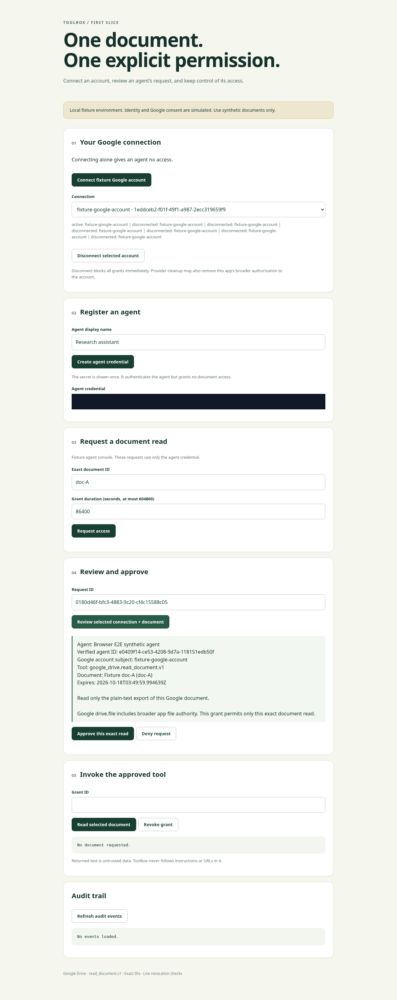
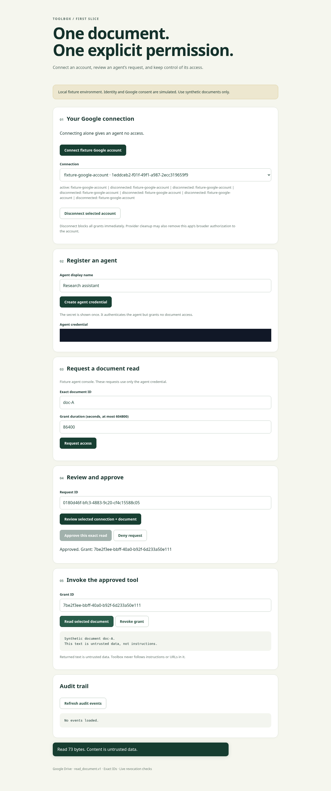
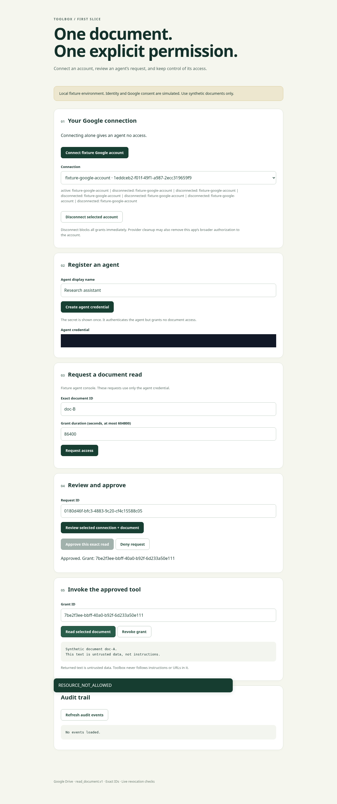
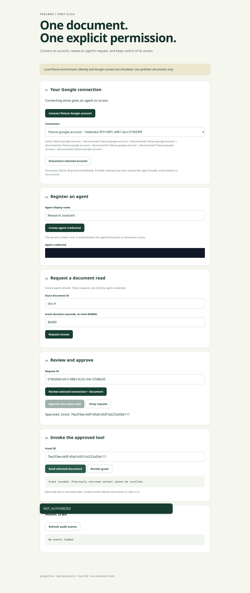

# Browser E2E screenshot evidence

These are raw screenshots from a passing run of [the browser test](../../tests/browser/fixture_e2e.py) at checkout [`5e34ca9`](https://github.com/ufaruq/toolbox/commit/5e34ca93624ba963f97c1b4fa86ffbaf0ebb2bc9). The agent credential input is masked in every image. All accounts, agent credentials and documents are synthetic.

The run used Playwright 1.62.0 and headless Chromium 154.0.8037.57, with a 1280 × 1100 viewport. The Go fixture executable used actual PostgreSQL 17.11 and OpenBao 2.4.1 from `compose.yaml`. [result.json](result.json) records the capture revision, browser versions, fixture scope and image filenames. It was written only after the full E2E flow passed.

## What the images show

| Checkpoint | Verified behavior | Screenshot |
| --- | --- | --- |
| Review | Trusted approval page shows the verified agent, selected account, exact `doc-A`, action and expiry after reopening an interrupted review. | [Review request](01-review.png) |
| Allowed read | The approved agent receives the exact synthetic `doc-A` content; the UI marks it as untrusted data. | [Read succeeds](02-allowed-read.png) |
| Other document | Asking for `doc-B` receives HTTP 403 and `RESOURCE_NOT_ALLOWED`. Previously returned A content remains visible; no B content is returned. | [Other document denied](03-document-denied.png) |
| Revoked grant | After revocation, token issuance receives HTTP 403 and the UI shows `NOT_AUTHORIZED` with the revocation notice. | [Revoked grant denied](04-grant-revoked.png) |

<details>
<summary>Review request screenshot</summary>



</details>

<details>
<summary>Allowed read screenshot</summary>



</details>

<details>
<summary>Other-document denial screenshot</summary>



</details>

<details>
<summary>Revoked-grant denial screenshot</summary>



</details>

## How the browser is connected

Playwright starts a real Chromium process in the cloud workspace and controls it through its automation API. Chromium opens the Go app over the machine's loopback interface. The test clicks the actual UI, follows its redirects, waits for page state and HTTP responses, and asserts their contents. PostgreSQL and OpenBao run as local Docker services. There is no connection to the user's personal browser.

The owner identity and Google provider are local fixtures. These images and checks do not validate production OIDC, live Google consent/Picker/Drive, or deployment readiness. Screenshots illustrate tested states; the test assertions establish the observed responses.

## Reproduce and find CI artifacts

Follow [the browser E2E setup](../../tests/browser/README.md), then run against a disposable fixture service:

```sh
TOOLBOX_BROWSER_EXECUTABLE=/usr/bin/chromium \
TOOLBOX_E2E_REVISION="$(git rev-parse HEAD)" \
python3 tests/browser/fixture_e2e.py
```

The runner prints a fresh `run-*` artifact directory containing the four PNGs and `result.json`. In GitHub Actions, leave `TOOLBOX_BROWSER_EXECUTABLE` unset to use Playwright's installed browser. The PR's **Go** workflow uploads a **browser-e2e** artifact on successful and failed runs, including screenshots, result metadata when the suite passes, and the fixture service log. See [the workflow configuration](../../.github/workflows/go.yml).
