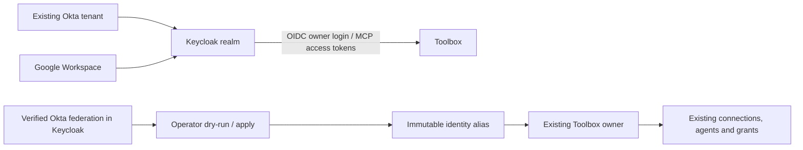

# Keycloak with Okta and Google Workspace

This optional backend makes Keycloak the OIDC issuer for Toolbox. Existing Okta
and optional Google Workspace accounts authenticate upstream. Direct Okta remains
the default when `TOOLBOX_IDENTITY_PROVIDER` is unset. Toolbox remains a local,
loopback-only application; this guide does not establish production readiness.



The user's original issuer/subject stays immutable. The verified Keycloak
issuer/subject is added as an alias to that same internal owner ID. Equal email
addresses are never proof of ownership and never merge Okta and Google accounts.

## Prerequisites and local Keycloak

Use Go 1.27.2 and the existing PostgreSQL/OpenBao setup. Keep a private copy of
your current `.env`, database backup and stable session/signing/credential
material. Never put secrets in this repository or a PR comment. Runtime settings
from [Workspace setup](workspace-demo.md) and Google Drive consent stay separate
from the Google login settings below.

Use Keycloak **26.8.2**, pinned to:

```text
quay.io/keycloak/keycloak@sha256:3879c623248408de29a5303178b5816c77e8dfef3890c361f8c0bbeaa979ba3b
```

Keycloak needs an HTTPS origin reachable by the browser and Toolbox, such as
`https://localhost:8443`, with issuer
`https://localhost:8443/realms/toolbox`. Use a certificate trusted by both. For a
private test CA, add only that CA to the browser/OS trust or supply its PEM in
the Go process's `SSL_CERT_FILE`; preserve other roots needed for Google/Okta.
Do not disable TLS verification. Keep Keycloak's administration interface private.

The automated check described below creates its own local CA and disposable
Keycloak container. For a persistent operator installation, follow the official
[Keycloak container guide](https://www.keycloak.org/server/containers) and
[production configuration guide](https://www.keycloak.org/server/configuration-production).
Configure its database, backups, TLS and restricted administration before using
real credentials. The generated import is applied with Keycloak's
`--import-realm`, mounted under `/opt/keycloak/data/import/`. Mounted realm and
key files must remain private and readable by the container's Keycloak user.
An existing realm is not overwritten by startup import; apply later changes
through reviewed administration rather than assuming a regenerated import updates it.

## Configure the upstream providers

1. Copy [.env.keycloak.example](../.env.keycloak.example) to a private, ignored
   file. Keep these settings separate from your current direct-Okta `.env`.

   ```sh
   mkdir -p work/keycloak
   chmod 700 work/keycloak
   cp .env.keycloak.example work/keycloak/private.env
   chmod 600 work/keycloak/private.env
   ```

2. In Okta, create a **new OIDC Web Application** for the broker. Keep the
   existing direct Toolbox application intact for rollback. Enable authorization
   code and client-secret authentication, use RS256 ID tokens, and assign the
   intended users. Register this exact sign-in redirect:

   ```text
   https://localhost:8443/realms/toolbox/broker/okta/endpoint
   ```

   Set the private file's `TOOLBOX_KEYCLOAK_OKTA_CLIENT_ID` and
   `TOOLBOX_KEYCLOAK_OKTA_CLIENT_SECRET` from this new application.
   Set `TOOLBOX_KEYCLOAK_OKTA_ISSUER` to the **exact issuer already used by your
   Toolbox owners**, normally `https://your-tenant.okta.com`. Do not replace an
   organization issuer with its custom API issuer during migration. Root Okta
   issuers use `/oauth2/v1/*` endpoints; custom issuers use their `/v1/*`
   endpoints. The generator handles that distinction.

3. To enable Google Workspace login, create a **separate Google OAuth Web
   application** with an appropriate consent screen and register:

   ```text
   https://localhost:8443/realms/toolbox/broker/google/endpoint
   ```

   Fill all three Google fields in the private file: client ID, client secret,
   and the exact Workspace hosted domain, for example `example.com`. The
   generated built-in Google provider validates the hosted-domain claim. Leave
   all three empty to omit Google login. These credentials do not replace
   `TOOLBOX_GOOGLE_*` used by Drive/Picker.

4. Set a new random `TOOLBOX_KEYCLOAK_OWNER_CLIENT_SECRET`; use a different
   secret from the upstream Okta application. The generated confidential client
   receives only `TOOLBOX_ORIGIN/auth/oidc/callback` as its callback. For example:

   ```text
   http://127.0.0.1:8080/auth/oidc/callback
   ```

5. Configure the public agent client map and exact callback URLs in
   `TOOLBOX_KEYCLOAK_MCP_CLIENTS` and
   `TOOLBOX_KEYCLOAK_MCP_REDIRECT_URIS`. The sample uses
   `http://127.0.0.1:8765/callback`; replace it with the callback your client
   actually uses. There are no wildcard redirects, client secrets, password
   grants or service accounts for agent clients. Authorization code with S256
   PKCE and the `mcp` scope are required.

6. Load the trusted private shell file and generate a new import path:

   ```sh
   set -a
   . work/keycloak/private.env
   set +a
   go run ./cmd/toolbox keycloak-config work/keycloak/realm.json
   ```

   The file contains client secrets, is created with mode `0600`, and cannot
   overwrite an existing file. Import it into the pinned Keycloak instance.
   The realm uses provider-prefixed usernames, duplicate emails with email login
   disabled, and a unique-user-only first-broker flow. Do not add automatic
   email-based account linking or broker-ID rewriting mappers.

## Preserve existing owners before cutover

1. First run this version of Toolbox with your **original direct-Okta
   configuration**. Startup applies additive migration 006, creating the identity
   alias/binding tables without changing existing users or grants. Keep the same
   database and cryptographic settings.

2. Each existing owner must establish its Okta federation in the new realm
   before aliases can be verified. Open the realm's Account Console at
   `https://localhost:8443/realms/toolbox/account/` and sign in through **Okta**.
   This creates the realm identity and its immutable upstream federation record.
   Do this before that user signs into Toolbox through Keycloak; an independently
   created Toolbox owner at the target identity is a conflict, not an automatic merge.

3. Create a **temporary confidential service client** named `toolbox-migration`
   in the new realm for the operator command. Enable service-account client
   credentials and grant only the `realm-management` read roles `view-users`,
   `query-users` and `view-identity-providers`. This client is separate from
   application clients and must never receive MCP permissions. Put its secret
   in `TOOLBOX_KEYCLOAK_ADMIN_CLIENT_SECRET` in the private file and reload it.

   On Keycloak 26.8.2, attach only **basic** and **kc-admin-api** as default client
   scopes on this migration client. `basic` supplies the subject;
   `kc-admin-api` supplies the scope and Admin API audience required by
   Keycloak's admin token validation. Keep both the Admin API audience check
   and TLS verification enabled. Do not attach `kc-admin-api` to Toolbox's
   owner or public MCP clients.

   On this **migration client only**, open Client scopes, its dedicated scope,
   Mappers, then Configure a new mapper of type **User Client Role**. Set:

   | Setting | Value |
   | --- | --- |
   | Name | `realm-management-read-roles` |
   | Client ID | `realm-management` |
   | Token Claim Name | `resource_access.realm-management.roles` |
   | Claim JSON Type | `String` |
   | Multivalued | On |
   | Add to access token | On |
   | Add to ID token / UserInfo | Off |

   Allow this client's assigned service-account roles in its scope; the tested
   operator client uses Full scope allowed with only the three read roles
   assigned. Do not add that mapper or admin roles to owner/MCP application
   clients. The operator service account never signs into Toolbox.

4. Stop the old Toolbox process for the final migration window. Load its
   original database configuration and the separate broker configuration:

   ```sh
   set -a
   . ./.env
   . work/keycloak/private.env
   set +a
   go run ./cmd/toolbox keycloak-link
   ```

   This is a **dry-run**: no identity links or audits are written and the CLI
   does not apply database migrations. It reads the pinned realm's provider
   configuration and actual federated identity records. It requires the `okta`
   provider's issuer to match the legacy issuer, signature validation enabled,
   immutable `sub` mapping, and no broker-ID rewriting. Every legacy owner must
   have exactly one matching enabled non-service realm user. Missing identities,
   ambiguous mappings and collisions stop the operation.

5. Once the dry-run reports the expected counts, apply:

   ```sh
   go run ./cmd/toolbox keycloak-link --apply
   ```

   The command re-verifies proof, checks current database ownership, and adds
   all aliases in one transaction with an audit trail. Repeating it is
   idempotent. It never changes primary identities, grants, connections, agents,
   credentials or caller approvals. Only counts appear in command output.

6. Disable/delete the temporary migration service client and remove its
   credentials from the runtime environment. The Toolbox process does not need
   Admin API access. Keep the original direct-Okta configuration for rollback;
   identity aliases are append-only and do not need deletion for rollback.

## Start through Keycloak and configure MCP

Keep the original database, OpenBao and signing/pepper settings. After loading
the two private files as above, override only the login/MCP settings:

```sh
export TOOLBOX_IDENTITY_PROVIDER=keycloak
export TOOLBOX_OIDC_ISSUER="$TOOLBOX_KEYCLOAK_ISSUER"
export TOOLBOX_OIDC_CLIENT_ID="$TOOLBOX_KEYCLOAK_OWNER_CLIENT_ID"
export TOOLBOX_OIDC_CLIENT_SECRET="$TOOLBOX_KEYCLOAK_OWNER_CLIENT_SECRET"
export TOOLBOX_MCP_ISSUER="$TOOLBOX_KEYCLOAK_ISSUER"
export TOOLBOX_MCP_CLIENTS="$TOOLBOX_KEYCLOAK_MCP_CLIENTS"
unset TOOLBOX_KEYCLOAK_ADMIN_CLIENT_SECRET
TOOLBOX_MODE=workspace-local go run ./cmd/toolbox
```

Use `TOOLBOX_MODE=oidc-local` for owner sign-in only. `make workspace` reloads
`.env`, so use the explicit command above while keeping the original file for
rollback. Old owner sessions need a fresh login after the issuer changes. An
Okta-brokered login should show the same Toolbox owner and existing connections.

For each MCP agent client configure the realm issuer, its public client ID,
exact callback, authorization code + S256, and scopes `openid mcp`. Use the
realm's standard OIDC discovery endpoints. Toolbox requires an access token
with its exact MCP audience, an allowlisted `azp`, a real user `sub`/`sid`,
`typ=Bearer` and scope `mcp`. ID tokens and client-credential tokens are rejected.

Create a fresh caller approval for the new issuer/client. The current caller
model creates a new agent for that approval, so approve its documents again.
Old approvals, agents and grants remain recorded with their original IDs but
are not transferred to a new OAuth caller. Existing independent HTTP agent
credentials retain their original authorization subject to their current
status and expiry. A new Google user is
a separate owner unless an independently reviewed linking process is introduced;
same-email Google login never receives another owner's Okta grants.

To roll back, stop Toolbox, load the original direct-Okta `.env`, explicitly set
`TOOLBOX_IDENTITY_PROVIDER=okta`, and restore the original owner issuer/client
and MCP issuer/client map before restarting. Primary identities and their records are intact.
Keep this version's binary and additive schema when rolling back the provider
configuration; an older binary does not understand verified identity aliases.
Do not restore an old database snapshot over new grants/audits without a
separately planned recovery procedure.

## Reproduce automated proof and perform live acceptance

```sh
docker pull quay.io/keycloak/keycloak@sha256:3879c623248408de29a5303178b5816c77e8dfef3890c361f8c0bbeaa979ba3b
make keycloak-check
```

This runs the real Keycloak image with a verified local CA and controlled OIDC
upstreams. The Google-shaped fixture uses generic OIDC in test configuration;
it is not a live Google account or proof of Google's built-in adapter. The
configured operator realm uses the built-in Google provider. The test checks
brokering, owner continuity, same-email separation, migration proof and the MCP
approval/read/revocation path. Temporary credentials/resources stay isolated.
The PR records the exact observed results and limits.

After external setup, verify both real providers independently: sign in twice,
check stable owner IDs, check the old Okta owner's data after migration, confirm
same-email accounts do not inherit each other's grants, approve a caller and
read one explicitly granted document, then revoke and disconnect. Verify logout
ends the Toolbox session; upstream/Keycloak browser sessions may still exist.
No live-provider acceptance is claimed by synthetic tests. mTLS, IAP,
self-service merging, general multi-tenancy and production rollout are follow-ups.
