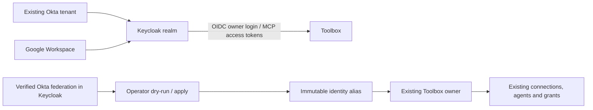

# Keycloak with Okta and Google login

This optional backend makes Keycloak the OIDC issuer for Toolbox. Existing Okta
and optional Google Workspace accounts authenticate upstream. Direct Okta remains
the default when `TOOLBOX_IDENTITY_PROVIDER` is unset. Toolbox remains a local,
loopback-only application; this guide does not establish production readiness.



The user's original issuer/subject stays immutable. The verified Keycloak
issuer/subject is added as an alias to that same internal owner ID. Equal email
addresses are never proof of ownership and never merge Okta and Google accounts.

## Prerequisites and local Keycloak

Use Go 1.27.2 and the existing PostgreSQL/OpenBao setup. Keep a private copy of
your current `.env`, database backup and stable session/signing/credential
material. Never put secrets in this repository or a PR comment. Runtime settings
from [Workspace setup](workspace-demo.md) and Google Drive consent stay separate
from the Google login settings below.

Toolbox's tests use Keycloak **26.8.2** from the reviewed
[patched image recipe](../deploy/keycloak/Dockerfile). It preserves the upstream
distribution, updates Guava, and uses a pinned Temurin Java 25 LTS runtime without
the unused GPG/SQLite packages. Java 25 LTS is a [supported Keycloak runtime](https://www.keycloak.org/server/supported-configurations); the short-lived Java 24 release is not used. This fixture does not enable or validate FIPS mode. Build it locally and use the returned immutable ID:

```sh
scripts/build-vendor-image keycloak
```

Keycloak needs an HTTPS origin reachable by the browser and Toolbox, such as
`https://localhost:8443`, with issuer
`https://localhost:8443/realms/toolbox`. Use a certificate trusted by both. For a
private test CA, add only that CA to the browser/OS trust or supply its PEM in
the Go process's `SSL_CERT_FILE`; preserve other roots needed for Google/Okta.
Do not disable TLS verification. Keep Keycloak's administration interface private.

The automated check described below creates its own local CA and disposable
Keycloak container. For a persistent operator installation, follow the official
[Keycloak container guide](https://www.keycloak.org/server/containers) and
[production configuration guide](https://www.keycloak.org/server/configuration-production).
Configure its database, backups, TLS and restricted administration before using
real credentials. The generated import is applied with Keycloak's
`--import-realm`, mounted under `/opt/keycloak/data/import/`. Mounted realm and
key files must remain private and readable by the container's Keycloak user.
An existing realm is not overwritten by startup import; apply later changes
through reviewed administration rather than assuming a regenerated import updates it.

## Configure the upstream providers

1. Copy [.env.keycloak.example](../.env.keycloak.example) to a private, ignored
   file. Keep these settings separate from your current direct-Okta `.env`.

   ```sh
   mkdir -p work/keycloak
   chmod 700 work/keycloak
   cp .env.keycloak.example work/keycloak/private.env
   chmod 600 work/keycloak/private.env
   ```

2. In Okta, create a **new OIDC Web Application** for the broker. Keep the
   existing direct Toolbox application intact for rollback. Enable authorization
   code and client-secret authentication, use RS256 ID tokens, and assign the
   intended users. Register this exact sign-in redirect:

   ```text
   https://localhost:8443/realms/toolbox/broker/okta/endpoint
   ```

   Set the private file's `TOOLBOX_KEYCLOAK_OKTA_CLIENT_ID` and
   `TOOLBOX_KEYCLOAK_OKTA_CLIENT_SECRET` from this new application.
   Set `TOOLBOX_KEYCLOAK_OKTA_ISSUER` to the **exact issuer already used by your
   Toolbox owners**, normally `https://your-tenant.okta.com`. Do not replace an
   organization issuer with its custom API issuer during migration. Root Okta
   issuers use `/oauth2/v1/*` endpoints; custom issuers use their `/v1/*`
   endpoints. The generator handles that distinction.

3. To enable Google login, create a **separate Google OAuth Web
   application** with an appropriate consent screen and register:

   ```text
   https://localhost:8443/realms/toolbox/broker/google/endpoint
   ```

   Fill the Google client ID and client secret in the private file. Leave the
   hosted domain empty to allow personal Gmail and Workspace accounts. Set an
   exact domain such as `example.com` only to restrict sign-in to that Workspace
   organization; the built-in provider then validates the hosted-domain claim.
   Leave all Google fields empty to omit Google login. These credentials do not replace
   `TOOLBOX_GOOGLE_*` used by Drive/Picker.

4. Set a new random `TOOLBOX_KEYCLOAK_OWNER_CLIENT_SECRET`; use a different
   secret from the upstream Okta application. The generated confidential client
   receives only `TOOLBOX_ORIGIN/auth/oidc/callback` as its callback. For example:

   ```text
   http://127.0.0.1:8080/auth/oidc/callback
   ```

5. Configure the public agent client map and exact callback URLs in
   `TOOLBOX_KEYCLOAK_MCP_CLIENTS` and
   `TOOLBOX_KEYCLOAK_MCP_REDIRECT_URIS`. The sample uses
   `http://127.0.0.1:8765/callback`; replace it with the callback your client
   actually uses. There are no wildcard redirects, client secrets, password
   grants or service accounts for agent clients. Authorization code with S256
   PKCE and the `mcp` scope are required.

6. Load the trusted private shell file and generate a new import path:

   ```sh
   set -a
   . work/keycloak/private.env
   set +a
   make keycloak-config
   ```

   The file contains client secrets, is created with mode `0600`, and cannot
   overwrite an existing file. Import it into the pinned Keycloak instance.
   The realm uses provider-prefixed usernames, duplicate emails with email login
   disabled, and a unique-user-only first-broker flow. Do not add automatic
   email-based account linking or broker-ID rewriting mappers.

## Preserve existing owners before cutover

1. First run this version of Toolbox with your **original direct-Okta
   configuration**. Startup applies additive migration 006, creating the identity
   alias/binding tables without changing existing users or grants. Keep the same
   database and cryptographic settings.

2. Each existing owner must establish its Okta federation in the new realm
   before aliases can be verified. Open the realm's Account Console at
   `https://localhost:8443/realms/toolbox/account/` and sign in through **Okta**.
   This creates the realm identity and its immutable upstream federation record.
   Do this before that user signs into Toolbox through Keycloak; an independently
   created Toolbox owner at the target identity is a conflict, not an automatic merge.

3. Create a **temporary confidential service client** named `toolbox-migration`
   in the new realm for the operator command. Enable service-account client
   credentials and grant only the `realm-management` read roles `view-users`,
   `query-users` and `view-identity-providers`. This client is separate from
   application clients and must never receive MCP permissions. Put its secret
   in `TOOLBOX_KEYCLOAK_ADMIN_CLIENT_SECRET` in the private file and reload it.

   On Keycloak 26.8.2, attach only **basic** and **kc-admin-api** as default client
   scopes on this migration client. `basic` supplies the subject;
   `kc-admin-api` supplies the scope and Admin API audience required by
   Keycloak's admin token validation. Keep both the Admin API audience check
   and TLS verification enabled. Do not attach `kc-admin-api` to Toolbox's
   owner or public MCP clients.

   On this **migration client only**, open Client scopes, its dedicated scope,
   Mappers, then Configure a new mapper of type **User Client Role**. Set:

   | Setting | Value |
   | --- | --- |
   | Name | `realm-management-read-roles` |
   | Client ID | `realm-management` |
   | Token Claim Name | `resource_access.realm-management.roles` |
   | Claim JSON Type | `String` |
   | Multivalued | On |
   | Add to access token | On |
   | Add to ID token / UserInfo | Off |

   Allow this client's assigned service-account roles in its scope; the tested
   operator client uses Full scope allowed with only the three read roles
   assigned. Do not add that mapper or admin roles to owner/MCP application
   clients. The operator service account never signs into Toolbox.

4. Stop the old Toolbox process for the final migration window. Load its
   original database configuration and the separate broker configuration:

   ```sh
   set -a
   . ./.env
   . work/keycloak/private.env
   set +a
   make keycloak-link
   ```

   This is a **dry-run**: no identity links or audits are written and the CLI
   does not apply database migrations. It reads the pinned realm's provider
   configuration and actual federated identity records. It requires the `okta`
   provider's issuer to match the legacy issuer, signature validation enabled,
   immutable `sub` mapping, and no broker-ID rewriting. Every legacy owner must
   have exactly one matching enabled non-service realm user. Missing identities,
   ambiguous mappings and collisions stop the operation.

5. Once the dry-run reports the expected counts, apply:

   ```sh
   make keycloak-link-apply
   ```

   The command re-verifies proof, checks current database ownership, and adds
   all aliases in one transaction with an audit trail. Repeating it is
   idempotent. It never changes primary identities, grants, connections, agents,
   credentials or caller approvals. Only counts appear in command output.

6. Disable/delete the temporary migration service client and remove its
   credentials from the runtime environment. The Toolbox process does not need
   Admin API access. Keep the original direct-Okta configuration for rollback;
   identity aliases are append-only and do not need deletion for rollback.

## Start through Keycloak and configure MCP

Keep the original database, OpenBao and signing/pepper settings. After loading
the two private files as above, override only the login/MCP settings:

```sh
export TOOLBOX_IDENTITY_PROVIDER=keycloak
export TOOLBOX_OIDC_ISSUER="$TOOLBOX_KEYCLOAK_ISSUER"
export TOOLBOX_OIDC_CLIENT_ID="$TOOLBOX_KEYCLOAK_OWNER_CLIENT_ID"
export TOOLBOX_OIDC_CLIENT_SECRET="$TOOLBOX_KEYCLOAK_OWNER_CLIENT_SECRET"
export TOOLBOX_MCP_ISSUER="$TOOLBOX_KEYCLOAK_ISSUER"
export TOOLBOX_MCP_CLIENTS="$TOOLBOX_KEYCLOAK_MCP_CLIENTS"
unset TOOLBOX_KEYCLOAK_ADMIN_CLIENT_SECRET
TOOLBOX_MODE=workspace-local make run-configured
```

Use `TOOLBOX_MODE=oidc-local make run-configured` for owner sign-in only. `make workspace` reloads
`.env`, so use `make run-configured` as above while keeping the original file for
rollback. Old owner sessions need a fresh login after the issuer changes. An
Okta-brokered login should show the same Toolbox owner and existing connections.

For each MCP agent client configure the realm issuer, its public client ID,
exact callback, authorization code + S256, and scopes `openid mcp`. Use the
realm's standard OIDC discovery endpoints. Toolbox requires an access token
with its exact MCP audience, an allowlisted `azp`, a real user `sub`/`sid`,
`typ=Bearer` and scope `mcp`. ID tokens and client-credential tokens are rejected.

Create a fresh caller approval for the new issuer/client. The current caller
model creates a new agent for that approval, so approve its documents again.
Old approvals, agents and grants remain recorded with their original IDs but
are not transferred to a new OAuth caller. Existing independent HTTP agent
credentials retain their original authorization subject to their current
status and expiry. A new Google user is
a separate owner unless an independently reviewed linking process is introduced;
same-email Google login never receives another owner's Okta grants.

To roll back, stop Toolbox, load the original direct-Okta `.env`, explicitly set
`TOOLBOX_IDENTITY_PROVIDER=okta`, and restore the original owner issuer/client
and MCP issuer/client map before restarting. Primary identities and their records are intact.
Keep this version's binary and additive schema when rolling back the provider
configuration; an older binary does not understand verified identity aliases.
Do not restore an old database snapshot over new grants/audits without a
separately planned recovery procedure.

## Reproduce automated proof and perform live acceptance

```sh
make keycloak-check
```

Run the focused command on Linux; use `make test-all` on macOS. It builds and
runs the patched Keycloak image with a verified local CA and controlled OIDC
upstreams. The Google-shaped fixture uses generic OIDC in test configuration;
it is not a live Google account or proof of Google's built-in adapter. The
configured operator realm uses the built-in Google provider. The test checks
brokering, owner continuity, same-email separation, migration proof and the MCP
approval/read/revocation path. Temporary credentials/resources stay isolated.
The PR records the exact observed results and limits.

After external setup, verify both real providers independently: sign in twice,
check stable owner IDs, check the old Okta owner's data after migration, confirm
same-email accounts do not inherit each other's grants, approve a caller and
read one explicitly granted document, then revoke and disconnect. Verify logout
ends the Toolbox session; upstream/Keycloak browser sessions may still exist.
No live-provider acceptance is claimed by synthetic tests. mTLS, IAP,
self-service merging, general multi-tenancy and production rollout are follow-ups.

## Toolbox login theme

The optional `deploy/keycloak/themes/toolbox` theme matches the Workspace UI's
paper background, green controls, serif heading and accessible focus rings. It
inherits Keycloak 26.8.2's `keycloak.v2` forms and scripts, including errors,
password visibility and provider redirects; it adds no external fonts or scripts.

Mount `deploy/keycloak/themes/toolbox` read-only at
`/opt/keycloak/themes/toolbox` in the Keycloak container. In Realm settings →
Themes, select **toolbox** as the Login theme and save. For a fresh realm import,
set `"loginTheme": "toolbox"` in the private import JSON after rendering it.
Existing realms require the administration setting; startup import does not
update them. The default generator keeps the stock theme so installations
without the theme mount continue working. To revert, select `keycloak.v2`.

Verify the login page, provider choices, error messages and narrow-screen layout
before rollout. The theme changes presentation only; enabled providers and
registration remain controlled by the realm configuration.

## Personal Gmail and Workspace login

Google login accepts both account types when
`TOOLBOX_KEYCLOAK_GOOGLE_HOSTED_DOMAIN` is empty. The Google client ID and secret
remain required. Set an exact hosted domain only when intentionally restricting
sign-in to one Workspace organization; wildcard and comma-separated domains are
rejected. For an existing Keycloak realm, remove its Google provider's Hosted
Domain setting through administration; generating a new import does not update it.

Configure the Google OAuth app for an External audience to admit personal accounts
and accounts outside your organization. While it is in Testing, enroll the intended
test users; publication/verification requirements depend on the selected scopes.
Register Keycloak's exact `/realms/<realm>/broker/google/endpoint` callback. This
is separate from Toolbox's Google Drive callback. Test one personal account and
one Workspace account, repeat login, logout, separate ownership and MCP access.
The broader audience does not link equal email addresses or share existing grants.
Real provider acceptance is pending until those accounts complete the live flow.

### Upstream-only authentication and existing realms

The generated realm now binds `toolbox-upstream-only` as its browser flow.
It offers upstream providers and has no password, WebAuthn, OTP or cookie-login
execution. The provider-selection subflow uses the built-in username screen
followed by a required Deny Access execution; submitting any local username
cannot authenticate. The optional Toolbox theme renders only provider choices
on that screen. The denial is enforced by the flow, independently of the theme.

Credential setup actions `UPDATE_PASSWORD`, `CONFIGURE_TOTP`,
`webauthn-register`, `webauthn-register-passwordless` and
`CONFIGURE_RECOVERY_AUTHN_CODES` are explicitly disabled. Native signup remains
out of scope. Disabling registration/reset alone is insufficient: an already
brokered user could otherwise create a password through Account Console actions.

For an existing realm, startup import does **not** apply this change. Use trusted
administration to create the two new flows exactly as generated, bind the new
browser flow, and disable those required actions. Check client-specific browser
flow overrides and remove any pointing to a password-enabled flow. Keep direct
access grants disabled on application clients. Remove existing local credentials
from brokered users and invalidate pre-change realm sessions as part of cutover;
do not change the separate master-realm administration flow. Then test provider
login and denial of local login and `kc_action=UPDATE_PASSWORD` before reopening
access. Existing Toolbox sessions remain subject to the separately documented
local revocation policy.

## Optional dynamic client registration

This opt-in supports **public OAuth clients** using authorization code + S256
PKCE. Hosted ChatGPT/Claude integrations may require confidential registration
or metadata this policy rejects; they are not established compatible by the
local acceptance test. A display name is not vendor verification.

Set these before generating a **new** private realm import:

```sh
export TOOLBOX_KEYCLOAK_DYNAMIC_CLIENT_REGISTRATION=true
export TOOLBOX_KEYCLOAK_DYNAMIC_REGISTRATION_TRUSTED_HOSTS='["127.0.0.1","localhost","::1"]'
```

The host list is required, bounded to 32 exact hosts, and accepts no wildcard,
URL, port, or path. Add an exact DNS host only when you trust callbacks there.
Callbacks use HTTPS, except literal loopback HTTP. The supported callback grammar
uses an explicit `/` path, ASCII letters/digits and `._~/-`, with optional query
characters `._~=&-`. Wildcards, fragments, userinfo and percent escapes are
rejected. Client metadata URLs (including logos, sector identifiers, remote keys,
and logout URLs) are rejected. Registration is not restricted by the requester's
source IP; the configured list constrains callback destinations.

The generated realm includes an enabled **`toolbox-dcr-setup-required`** client
policy. It blocks anonymous registration and registration-token updates until
setup is complete. Keep it enabled during the following one-time administrator
setup in Keycloak. This is Keycloak configuration, not a central Toolbox admin
role or a client approval.

1. Import the realm with registration still closed. In the Keycloak Admin
   Console, select the Toolbox realm and open **Client scopes**.
2. Change the realm default assignment of all scopes to **None** except
   **basic → Default** and **mcp → Optional**. Remove the default/optional
   assignments, not the scope definitions or their assignments on existing
   clients. Existing built-in account/admin clients must keep their scopes.
3. Verify that future clients inherit only `basic` and can request only `mcp`.
   Under **Realm settings → Client policies**, disable only
   **`toolbox-dcr-setup-required`**. Leave the other Toolbox policies enabled.
4. Start Toolbox with `TOOLBOX_MCP_DYNAMIC_CLIENT_ONBOARDING=true`, the Keycloak
   identity backend and exact issuer settings. Follow the
   [owner approval flow](mcp-setup.md#owner-approval-for-new-keycloak-clients).

Why the separate step: Keycloak 26.8.2 realm import **adds** default scope
assignments rather than replacing them. Retaining its factory-generated scopes
preserves normal built-in client behavior; the administrator step restricts
future registrations. The setup gate prevents incomplete configuration from
opening registration, including requests with no `scope` field. For an existing
realm, startup import does not apply changes: install and review the policies
through Keycloak administration with this gate enabled first.

Clients discover `/realms/<realm>/clients-registrations/openid-connect` through
OIDC metadata. Registration creates an OAuth client only. A signed user token
must then match an existing active Toolbox owner to create a pending candidate.
The owner must sign into Toolbox separately and approve that candidate. A shared
SSO login can reduce login prompts but cannot replace either approval.

Native policies apply to creation and registration-token updates: public client
only, S256, no password/implicit grants, no full scope or applicant-supplied
protocol mappers, consent required, only `basic`/`openid`/`mcp` scopes, and a
128-client realm quota. Both anonymous and authenticated registration chains
retain restrictions. Device/CIBA and other unsupported grant settings are denied;
MCP scopes also have a code/refresh-only runtime policy. The legacy default
registration endpoint is covered by the same restrictions and tested against
mapper injection and PKCE downgrade; applications should use OIDC registration.

Pinned native limitations are explicit:

- The quota counts **all** realm clients and is a count-before-create check,
  not an atomic cap under concurrent registration. It is not a rate limiter.
  Keep this local setup private; externally exposing it requires separately
  configured edge rate limiting and operational quota monitoring.
- Public client metadata may request service accounts at creation, but public
  clients cannot obtain client-credentials tokens. Registration-token updates
  cannot enable service accounts. Toolbox independently rejects service tokens.
- A pairwise subject request can create Keycloak's derived-subject mapper. Its
  different subject does not match the owner's identity, so Toolbox denies it
  without a candidate. Do not use pairwise subjects for this onboarding flow.
- Keycloak returns HTTP 500 for a public client requesting UMA authorization
  services. Acceptance checks that the failed creation is rolled back. Toolbox
  configures no UMA resource server and does not support UMA access.

These behaviors are tested against the pinned image, including unchanged static
MCP access and real owner/document approvals with synthetic upstream providers.
They do not establish live Google/Okta or hosted-client compatibility. No live
realm is modified by generating the configuration or running repository tests.

Implementation references: [Keycloak registration policies](https://www.keycloak.org/securing-apps/client-registration),
[pinned realm import](https://github.com/keycloak/keycloak/blob/26.8.2/model/storage-private/src/main/java/org/keycloak/storage/datastore/DefaultExportImportManager.java),
[pinned registration lifecycle](https://github.com/keycloak/keycloak/blob/26.8.2/services/src/main/java/org/keycloak/services/clientregistration/AbstractClientRegistrationProvider.java).
