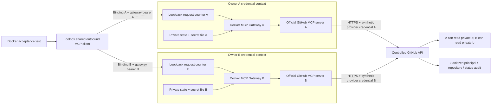

# Docker MCP Gateway pilot

This pilot runs Toolbox's shared outbound MCP client through a real Docker MCP
Gateway and the existing GitHub Official MCP server. Two synthetic owners use
separate gateway credentials, gateway state and provider credentials. A controlled
HTTPS GitHub API supplies distinguishable private issue data and a sanitized
request audit.

The application still exposes its existing Google document flow. This PR adds
the reusable client and a reproducible Docker acceptance test; it does not add a
GitHub connection screen, repository grant, or agent-facing GitHub action. Those
follow the [service connector plan in PR #9](https://github.com/ufaruq/toolbox/pull/9).
The [feasibility record](experiments/mcp-github-feasibility.md) separates the
controlled test evidence from the remaining live-provider gates.

## What runs



The request counters are test instrumentation. They transparently forward to the
actual gateways and let the test prove that a rejected binding sent no HTTP
request. The API is synthetic; the gateway and GitHub MCP server are the pinned
upstream images, not replacements implemented for the test. Toolbox contains no
new GitHub issue REST connector.

The test uses a dedicated Docker bridge and publishes HTTP endpoints only on
`127.0.0.1`. This bridge permits outbound traffic; it is not an egress-denial
test. The API uses a generated CA and verified TLS, including from the official
server. Gateway signature verification stays enabled.

## Run the end-to-end check

1. Use Linux with Go **1.27.2**, `make`, and a running local Docker Engine/CLI.
   The harness explicitly uses `unix:///var/run/docker.sock`; remote Docker
   contexts are unsupported. The Go process and Docker daemon must see the same
   absolute temporary-file paths because the gateways bind-mount generated
   catalogs, certificates and synthetic secret files. The recorded environment
   used Linux/amd64 and Docker Engine 28.4.0.

   ```sh
   go version
   docker --host=unix:///var/run/docker.sock version
   ```

   The invoking user needs permission to use that socket. Use a development
   daemon: mounting its socket gives the gateway authority over that daemon.
   Docker Desktop, an Okta tenant, a GitHub account, and real provider tokens are
   unnecessary for this controlled check.

2. From the implementation branch's repository root, pull the exact images.
   The test requires these images to exist locally and does not substitute
   mutable tags.

   ```sh
   docker --host=unix:///var/run/docker.sock pull docker/mcp-gateway@sha256:b0a3876ffbb352813d658cf25c137b8eae29bbe23db5944560a1c9059533bb16
   docker --host=unix:///var/run/docker.sock pull ghcr.io/github/github-mcp-server@sha256:250bc6ce70788207608ef74cef4397230ff2e8481218da74d6093e4bd9101132
   ```

3. Download Go dependencies, then run the ordinary checks. These do not require
   Docker and skip the opt-in Docker test.

   ```sh
   go mod download
   make check
   ```

4. Run the real Docker acceptance test. Use a temporary directory visible to
   the local daemon; `/tmp` is suitable for the tested topology.

   ```sh
   TMPDIR=/tmp make mcp-gateway-check
   ```

   The equivalent command is:

   ```sh
   TMPDIR=/tmp TOOLBOX_TEST_DOCKER_MCP=1 go test -race -count=1 ./internal/mcpclient -run '^TestDockerGatewayOwnerIsolation$' -v -timeout=9m
   ```

   Do not put real credentials in the test. It generates synthetic tokens and
   short-lived certificates, compiles the small controlled API into a `scratch`
   image, starts one API and two isolated gateways, and lets those gateways
   launch the official GitHub MCP servers. The production outbound client then
   performs the calls. No `.env` file is loaded.

5. Require `PASS` for `TestDockerGatewayOwnerIsolation` and the final sanitized
   audit summary. The output includes the observed gateway handshake, image
   digests and tool-schema hashes. A passing normal `make check` alone does not
   establish that Docker acceptance ran.

   The Docker test checks:

   - Concurrent `get_me` calls return each owner's own identity.
   - Each credential reads its own private issue through `issue_read` with
     `method=get`; the controlled provider rejects the other private repository.
   - Changing the owner, connection ID, or epoch in a binding fails before any
     gateway request.
   - Owner A's gateway bearer cannot authenticate to B's gateway and reaches no
     provider endpoint there.
   - Stopping A's gateway fails its calls while B continues to work; restarting
     A restores its original credential context.
   - Closing the separate restarted A client prevents further calls from that
     client while B continues to work.
   - Successful repository requests in the provider audit match their credential
     principal, and known test credentials appear in neither results nor errors.

6. The harness registers cleanup for its uniquely named containers, their
   child servers on its task network, that network, the temporary API image and
   generated files. It retains the two pulled upstream images. If the process is
   forcibly killed, inspect only names beginning `toolbox-mcp-` and the unique
   `toolbox.mcp.e2e` label/network from that run; remove only confirmed test
   resources. Do not use a global Docker prune command.

## How credentials are separated

The production package receives an operator-configured endpoint and gateway
bearer for each immutable `Binding`. A binding contains its ID, owner ID,
connection ID and epoch. All four must match the configured entry. Callers do
not select an endpoint, raw secret, image, Docker profile or downstream server.
The client rejects sharing an endpoint or gateway bearer across its bindings.

Each test gateway has its own state directory mounted at `/root/.docker/mcp`
and one explicit mode-`0600` `secrets.env`. Its catalog maps
`github.personal_access_token` to the official server's
`GITHUB_PERSONAL_ACCESS_TOKEN`. The client only knows the gateway bearer; the
synthetic provider credential stays in that gateway/server context. Explicit
`--secrets` avoids the Docker Desktop default secret source. Separate profile
names or `DOCKER_CONFIG` alone are not used as the credential boundary.

The gateway has fixed `--servers=github-official` and exposes only `get_me` and
`issue_read`. Its catalog also sets `GITHUB_READ_ONLY=1` and the same two-tool
allowlist. Automatic catalog watching and tool-call logging are disabled. The
gateway discovers the bridge network from its own container and attaches its
server there; the harness does not use `--static` or an unsupported gateway
`--network` argument.

These containers share a trusted Docker daemon. This proves application binding
and secret routing in the tested topology, not isolation from a malicious daemon
operator, a compromised gateway, or arbitrary unreviewed MCP server images.

## Reusing the client for another service

The common package is [internal/mcpclient](../internal/mcpclient). It handles
gateway authentication, fixed protocol/server identity, schema fingerprints,
argument validation, cancellation, bounded results and session cleanup. Its
operator configuration supplies approved tool schemas; discovery does not
automatically grant an agent permission to use them. Unit tests exercise two
different service schemas through the same implementation.

For a later provider, review and pin its existing server image, approve its
tools and schemas, create an isolated gateway credential context, and configure
the corresponding binding. Provider-specific Toolbox code must still map an
owner-approved action/resource into bounded arguments and validate the result.
The gateway does not replace Toolbox's identity, connection lifecycle, grant,
approval, revocation, or final authorization checks.

The client accepts text and structured JSON, rejects unsupported content and
server-side action requests, follows no result links, and retries no dispatched
call. Its maximum operation deadline is 20 seconds; arguments are limited to
16 KiB. HTTP response bodies, including cumulative SSE framing, and the encoded
tool result are bounded to 1 MiB. A shorter caller deadline applies first.

## Before a live GitHub rollout

The controlled API authenticates synthetic token strings according to its own
rules. This does not establish that GitHub accepts a real fine-grained token or
installation credential, that its scopes are sufficient, or that access remains
bound to an immutable repository ID through rename, transfer or locator reuse.
Those Task 1 gates remain open.

Tasks 3–5 still need provider-specific resource policy, persisted repository
grants, connection lifecycle and credential refresh/cleanup, authorization before
dispatch and after network I/O, opt-in runtime configuration, UI, and live
acceptance. Do not point the pilot at a real account and treat a successful read
as completion of those controls. The existing Google/MCP revocation,
disconnect and client-isolation follow-up remains separate.
