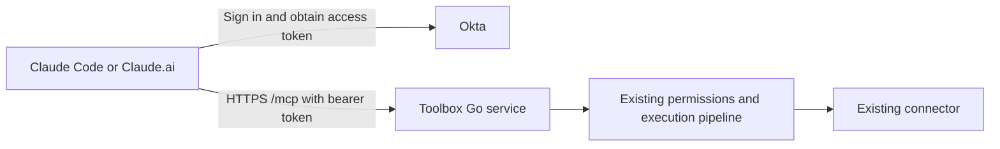

# Hosted MCP with direct Okta authentication

Status: scope approved; implementation authorized by the user. This specification does not itself claim implemented or deployed behavior. It replaces the earlier authorization-gateway proposal.

## Outcome and scope

Let Claude Code, Claude.ai and other explicitly registered callers use one hosted Toolbox MCP endpoint. Users sign in through Okta and choose the tools, documents and access duration available to each caller. Preserve the existing approval, exact-document authorization, revocation and audit behavior.

Use the existing Go service, PostgreSQL and secret-store adapters. Add the MCP endpoint and Okta integration inside that service. Do not add Ory Hydra, another authorization server, an authentication broker, a separate MCP proxy process, device attestation or per-installation token infrastructure.

The inspected application baseline is `3e66310`. It supports one provider tool, `google_drive.read_document.v1`; the runnable executable still uses fixture owner identity and Google. Register only implemented tools and distinguish fixture tests from real-provider acceptance.

## Architecture

Okta issues and refreshes API access tokens. Toolbox validates those tokens and enforces its own stored permissions. The hosting platform supplies public HTTPS. MCP and the owner UI share the existing application container and stores.

Use the official Go MCP SDK with stateless Streamable HTTP. Both local Claude Code and hosted Claude.ai call the same URL; this delivery does not need a separate local stdio server.

## Caller identity and permission granularity

An approved caller profile is keyed by trusted Okta issuer, immutable Okta user ID and registered OAuth client ID: `(issuer, uid, cid)`. Give Claude.ai and Claude Code separate allowlisted Okta client registrations and map each profile to its own existing Toolbox Agent. Configure a consistent immutable Okta user-ID claim for owner login and MCP tokens; never identify owners by email or assume a configurable access-token subject matches the owner ID token's subject.

This version separates registered callers. Multiple logins or installations using the same user/client registration share that profile and its permissions. Independent profiles for two installations require separate client registrations. Names such as “Claude Code — work laptop” are display labels, not proof of physical origin. Do not infer a separate connection from a token's `jti`, browser session, MCP session ID, IP address or caller-provided label.

The database enforces one profile per identity tuple and immutable owner/Agent/client bindings. The profile stores status, tool allowlist, display label, approval time and user-selected expiry, capped at 30 days. Refreshing a token extends neither profile nor document-grant authority. Existing Google `domain.Connection` retains its separate meaning: a provider account connection.

## Okta and Claude configuration

Use an Okta custom authorization server configured for Toolbox's API audience, the exact public MCP URL. Configure the required API scope `mcp` and optional refresh scope `offline_access`. Okta remains the only authorization server; Toolbox does not issue MCP access or refresh tokens.

Pre-register the supported clients. Claude Code uses an authorization-code native/public client with S256 PKCE, token authentication method `none`, and an exact registered loopback callback with a fixed configured port. Claude.ai uses an authorization-code confidential client with S256 PKCE, token authentication method `client_secret_basic`, and callback `https://claude.ai/api/mcp/auth_callback`. Provide the matching client ID and confidential-client secret through Claude's supported connector settings. Do not require dynamic client registration.

Serve MCP protected-resource metadata pointing directly to the configured Okta issuer. Unauthenticated requests receive `401` with `WWW-Authenticate` and a `resource_metadata` pointer. Metadata advertises the actual API scope and resource URL. Verify discovery, S256 PKCE, callback matching, code exchange, API audience and refresh against the chosen Okta configuration and clients; do not claim compatibility from configuration alone.

For owner login, implement the normal Okta OIDC authorization-code callback, state/nonce/PKCE checks and secure first-party session lifecycle in Toolbox. Validate signatures, issuer, client audience, time and nonce with a maintained library. Owner sessions, API access tokens and Google provider credentials have separate roles. An owner session or OIDC ID token cannot authenticate an MCP call.

## Owner approval and shared enforcement

The owner signs in to Toolbox, selects a registered caller, approves its tool ceiling and expiry, and manages that caller's existing exact-document requests/grants. A valid Okta token does not automatically approve a profile or any document. Unapproved or disabled profiles receive a clear denial and instructions to use the owner UI; they do not enter a repeated sign-in loop.

For each MCP HTTP request, validate the access token's allowed signature algorithm, signature, configured issuer, exact API audience, lifetime, required scope, user-bound `uid` and allowlisted `cid`. Resolve the matching active owner/profile/Agent server-side. Reject ID tokens, machine-only tokens, unknown clients, expired profiles and mismatched identities. Cache signing keys with rotation support, not positive permission decisions. Never accept a caller-selected issuer, key URL, Agent ID or profile ID as authentication.

Pass an explicit server-established caller context into the existing authorization/execution path. Adapt that path to support both existing opaque agent credentials and validated Okta profiles; retain the original credential checks for HTTP credential authentication. Do not bypass authorization with an empty credential or create a second policy engine. No shared backend credential, internal HTTP proxy or additional credential vault namespace is needed for MCP.

If an Agent is linked to a caller profile, enforce that profile's current status, expiry and tool ceiling for every authentication path to that Agent. Check active owner/Agent/profile, exact document grant and token expiry before provider credential access, each provider dispatch/retry and final content release. Preserve buffering, timeouts, cancellation, rate limits and audit failure behavior. Profile-aware authorization must also govern owner approval of requests for that Agent.

Tool discovery reflects the active profile's permitted tools. Every invocation independently checks current permissions, including when a client cached an earlier tool list. The authenticated caller context and filtered catalog are request-scoped and cannot leak across users.

## MCP tool surface

| Tool | Required input | Existing behavior |
| --- | --- | --- |
| `toolbox_request_document_access` | `file_id`, `duration_seconds` | Create a Drive-read delegation request for this Agent and promptly return the trusted approval URL. |
| `toolbox_get_access_request` | `request_id` | Poll only this Agent's request; status does not establish live grant authority. |
| `google_drive_read_document_v1` | `file_id`, `grant_id` | Internally issue a fresh existing delegation token and run the existing approved-document invocation. |

Reject extra properties. Preserve the existing file-ID rule `[A-Za-z0-9_-]{1,256}` and duration range 1–604800 seconds. Request/grant IDs use Toolbox's canonical UUID shape. Creating an access request and reading require the Drive tool in the profile allowlist; status polling remains limited to owned requests. Owner approval remains in the trusted browser UI.

Use standard MCP text results containing the operation result JSON. Preserve invocation/document metadata and `untrusted_content: true`; provider text remains data. Keep provider tokens, agent credentials and delegation tokens out of MCP arguments, output and logs. Return sanitized operation failures with `isError: true`; let the SDK handle protocol errors. Preserve the existing 1 MiB document-content limit and bound protocol bodies with room for JSON escaping.

## Disable, enable and token lifecycle

Disable a caller profile in one database transaction: mark it inactive, deactivate its linked Agent, revoke its document grants, cancel all its pending delegation requests and append an audit event. Live checks must prevent content release from reads in progress. Other caller profiles and the shared Google account connection remain usable.

Enabling that profile again requires an explicit owner action and applies to all currently valid Okta tokens matching the same user/client identity, including tokens issued earlier. This is the deliberate logical-client permission model. Enable restores neither old document grants nor pending requests; documents require fresh requests and approval. Profile enable/disable is not a claim that Okta access or refresh tokens were revoked.

An Okta refresh still authenticates the same profile and cannot auto-enable it. Do not claim independently revocable refresh-token families or per-login connection generations. Those require a separately reviewed identifier/lifecycle contract if requested later; they are not a reason to add infrastructure to this delivery.

All owner mutations require owner authentication, same-origin checks and CSRF protection. Reducing a tool allowlist revokes affected grants and cancels pending requests in the same transaction. Increasing it requires explicit owner approval and creates no document rights by itself. Record verified caller registration, Agent and owner attribution in approvals and audit.

## Deployment and verification

Build one application image and reuse the existing store adapters and deployment topology. Keep stores private, configure verified TLS and secret injection, persist signing keys and the credential pepper, and use non-root runtime, graceful shutdown and existing health/readiness checks. Pin added SDK/library dependencies. Hosted startup validates required Okta/public-origin/store settings and exposes no fixture login or fixture Google authorization routes.

Automated acceptance must exercise an actual SDK client over HTTP, Okta-protocol fixtures, shared gateway enforcement and the owner UI/API. The decisive scenario uses one user with two client registrations: web can read document A, Code can read B, and each is denied the other's grant/request. Disable Code during export: no content returns and web continues working. Explicitly enable Code: its old grants and pending requests remain denied, and fresh approval is required.

Also verify wrong signature/issuer/audience/client/user/scope, ID and machine tokens, token/profile expiry during execution, forged labels or IDs, concurrent profile creation, credential-auth compatibility, revocation/disconnect, dependency failures, cancellation, size limits, secret redaction and restart persistence. Multiple tokens for the same registered caller must resolve the same logical profile. Existing formatting, vet, race and build checks remain required; report store/browser checks according to actual available dependencies.

Real Okta + Claude Code + Claude.ai acceptance is separate from fixture/SDK tests and requires tenant/client access and interactive sign-in. Live Google wiring, Picker, project configuration and provider acceptance remain the existing backend milestone. Keep that limitation explicit; the current fixture does not prove a public real-Google deployment.

Repository implementation can proceed without production credentials. Deployment and live acceptance need the Okta issuer/client settings, hosting/domain/store access and Claude test clients. Use the platform's secret mechanism for sensitive values. Do not introduce another authorization service to replace missing configuration or expand into unrequested tools/providers.

Corporate provider-account eligibility is an independently requested PR: for example, an owner authenticated as `ufaruq@company.com` may connect only the permitted same-person corporate Google account. The MCP PR enforces owner/caller/grant isolation; it does not claim verified cross-provider email/domain equality. The separate PR must obtain trusted owner identity, validate provider identity at OAuth completion, reject mismatches before activation, and preserve cleanup of issued credentials. A matching domain or a login hint alone is not evidence of the same account.

## References

- Existing gateway boundary: `docs/design/user-delegated-connections.md`, “Later extensions”; `docs/ROADMAP.md`, F1.
- Okta API authorization servers: https://developer.okta.com/docs/concepts/auth-servers/
- Okta token validation and client/user claims: https://developer.okta.com/docs/guides/validate-access-tokens/go/main/
- Claude connector authentication: https://claude.com/docs/connectors/building/authentication
- Claude Code registered OAuth clients: https://code.claude.com/docs/en/mcp#use-pre-configured-oauth-credentials
