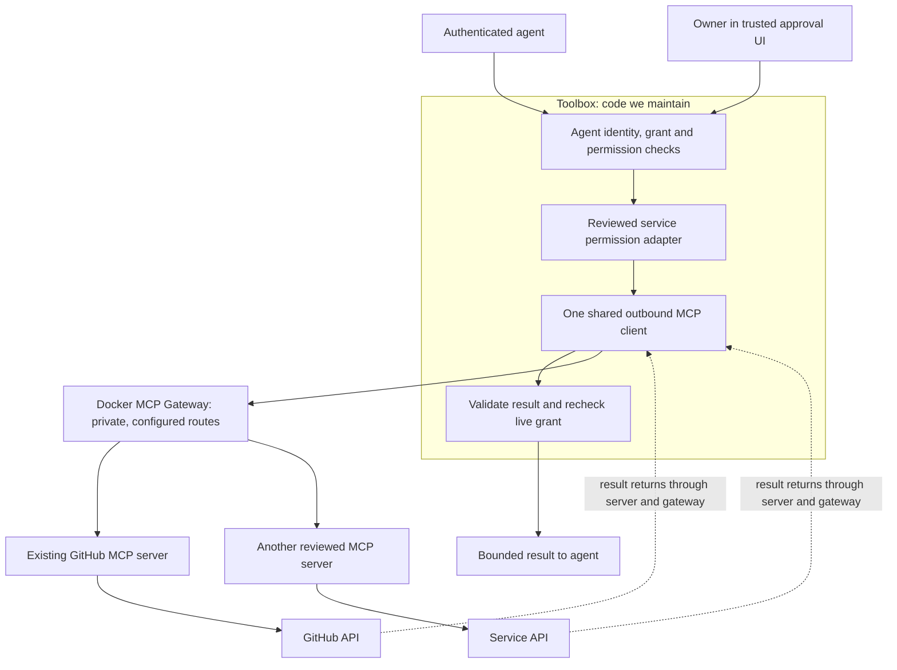

# Reusing MCP service connectors with Docker Gateway

**Status:** Docker MCP Gateway is the selected runtime for new MCP-backed service connectors. This PR records that decision and updates the implementation plan; it does not implement or deploy the gateway/client, migrate credentials, or replace the existing Drive connector.

**Goal:** Make adding services to Toolbox cheaper by reusing existing MCP servers while preserving owner-approved, agent-specific access to selected resources.

**Companion:** [Validation and implementation plan](../plans/2026-10-18-mcp-service-connectors.md).

## What we get

An MCP server is a reusable service connector. For example, GitHub's existing server already implements GitHub operations and describes their inputs. Toolbox can call that server using the same protocol it uses for another service's MCP server.

We build one outbound MCP client in Toolbox and route new MCP-backed service calls through Docker MCP Gateway. The gateway manages the reviewed servers' configuration, execution and routing. For supported services, adding an integration becomes server configuration plus a reviewed permission mapping and acceptance tests, instead of another complete REST client.

The reusable server supplies the API implementation. Docker supplies the selected way to configure and operate it. Direct MCP connections remain a protocol alternative, but are not an implementation option or automatic fallback in this plan. The existing custom Google Drive path stays in place.

Use the MIT-licensed open-source gateway on Docker Engine for the server deployment. Docker Desktop is an optional developer convenience with separate licensing; paid enterprise/governance services are not required. Pin gateway, server image and SDK revisions before runtime implementation.

| Work needed for another service | Proposed responsibility |
| --- | --- |
| Provider API requests, response translation and tool input descriptions | Existing provider MCP server, where suitable |
| Protocol negotiation, tool inventory and tool calls | One shared Toolbox MCP client |
| Container lifecycle, server configuration, routing and tool allowlists | Docker gateway and its operator |
| Provider sign-in, credential storage and refresh | Explicitly selected credential owner: gateway/server or Toolbox; verify support per integration |
| Owner approval, authenticated agent, resource/action/expiry limits, revocation and application audit | Toolbox |
| Mapping approved resources to the server's tools and arguments | Small, provider-specific Toolbox policy adapter |

There is no promised percentage reduction yet. The first pilot measures custom API code avoided, policy code still required, setup work and operational cost.

## Current baseline and related work

The integration baseline is `main` commit `cac87b6d2d7d1f869c1794a68e63e3f874222aea`. It includes the original Drive authorization/token lifecycle, merged Okta owner login, optional corporate account linking, the `workspace-local` real Google runtime and the incoming MCP endpoint. These are code integrations, not a claim that every real provider/client acceptance gate has passed. See [implementation status](../../implementation-status.md), [Google setup](../../google-setup.md) and [MCP setup](../../mcp-setup.md).

- [PR #3](https://github.com/ufaruq/toolbox/pull/3), [PR #5](https://github.com/ufaruq/toolbox/pull/5) and [PR #6](https://github.com/ufaruq/toolbox/pull/6) are merged: roadmap, owner login and optional corporate account matching.
- [PR #10](https://github.com/ufaruq/toolbox/pull/10) is merged: real Google/Picker runtime using existing grants and provider adapters.
- [PR #7](https://github.com/ufaruq/toolbox/pull/7) is merged: the **inbound MCP endpoint**, through which agents call Toolbox. Reuse its shared owner identity, caller profiles, grant checks and existing MCP SDK rather than rebuilding them. It does not provide this outbound service-connector client.
- [PR #8](https://github.com/ufaruq/toolbox/pull/8) proposes service-account principals. The first connector pilot here keeps the existing human-owner model.

This design PR remains separate from runtime implementation. Integrate from then-current `main`, preserve its existing migrations and session guarantees, and coordinate any secret/deployment changes with [PR #4](https://github.com/ufaruq/toolbox/pull/4).

## Proposed architecture

This is an execution path through Toolbox. The agent receives no separate access to the downstream gateway, its management tools, server credentials or arbitrary provider tools. Discovery supplies inventory for operator review; it does not automatically grant agents new capabilities.

There are two independent MCP roles: Toolbox may be an MCP **server** for incoming agent requests, and a shared MCP **client** for outgoing service calls. Their authentication and sessions are distinct. Never forward an incoming Okta token or internal delegation token as a provider credential.

### Example: read an issue from one repository

The first candidate is GitHub Official, using one read operation on an issue in a dedicated test repository. The current upstream tool is `issue_read` with `method=get`; the pilot must confirm that exact tool/schema against its pinned server inventory.

1. The owner connects a test GitHub identity and approves an authenticated agent to read issues in one selected repository until a specified expiry.
2. Toolbox resolves that repository to the provider's stable repository ID and records the approved connection, action, resource and expiry. The first supported operation reads one requested issue; it does not list/search across repositories or follow links to other resources.
3. The policy adapter validates the issue number and constructs the approved server/tool/method/repository arguments. The agent cannot choose a server URL, credential reference, alternate method or raw forwarded arguments.
4. The shared client makes the MCP call through the selected private gateway route. The existing server performs the GitHub API request.
5. Toolbox checks that the returned issue belongs to the approved repository, validates and bounds the result, rechecks current authorization, records the outcome and releases content as untrusted data.

Repository rename, transfer or an ambiguous identity match must fail closed until the owner reviews the connection/resource again. The selected route must enforce the approved stable repository ID throughout the upstream read, using ID-bound execution or provider-enforced credentials restricted to that repository ID. A separate identity lookup followed by a broadly credentialed, name-based read is insufficient: the old owner/name can be reused between lookup and dispatch. Verify old-locator reuse and identity changes during that interval; response rejection alone is insufficient. If the server/credential route cannot enforce this or establish result provenance without recreating substantial API code, record the incompatibility and reject or narrow the pilot.

## Toolbox integration boundaries

| Existing component | Effect of this proposal |
| --- | --- |
| `internal/connectors`, `internal/app/integration.go` | Add an MCP-backed execution path for a new service; preserve the existing Drive path during the pilot. A suitable provider server may later replace some direct API execution. |
| `internal/oauth`, `internal/tokens` | Candidate for reduced provider-specific work only when the chosen server/gateway demonstrably owns the required consent, refresh, disconnect and cleanup lifecycle. No wholesale deletion is proposed. |
| `internal/security`, `internal/server/delegation.go`, live grant checks | Retain the authorization contract. Adapt it to the new action/resource type with additive persistence; do not reinterpret document IDs as repository IDs. |
| `internal/store` and grant/connection audit | Retain authoritative grants, expiry, revocation and approval evidence. Gateway call logs supplement these records. |
| Owner login and approval UI | Retain trusted owner identity and review. Docker's provider login does not establish a Toolbox owner session. |
| Merged inbound MCP work from PR #7 | Reuse current owner/caller identity, SDK and authorization; add the outbound client as a separate responsibility. |

The future client lives in `internal/mcpclient`; the first permission adapter lives in `internal/servicepolicy/github`. Operator-controlled bindings select an exact server identity, tool/schema revision and connection credential context. Generic transport code does not decide authorization. The service adapter does not implement GitHub's issue REST client.

## Credential and permission requirements

### Owner-to-connection isolation

Docker documents that OAuth credentials are shared across profiles in one installation. **A profile is not an owner credential boundary.** A single shared profile or mutable process-wide token must not select credentials for concurrent Toolbox users.

Start the local feasibility probe with one synthetic owner and one dedicated test credential. Before any multi-user pilot, select and verify either isolated gateway/server credential contexts per connection, or a documented gateway mechanism that binds each authenticated invocation to the correct owner-specific connection. The binding is chosen from trusted persisted state, never agent arguments. Unsupported isolation blocks multi-user use.

Disconnect must invalidate the Toolbox connection and grants before remote cleanup. Credential-context reuse after disconnect/reconnect is forbidden. Verify concurrent owners, refresh, crash/restart and in-flight disconnect behavior before moving any current token-management responsibilities. An allowlisted tool does not automatically narrow the underlying provider credential; provision least-privilege credentials independently.

### A bounded tool surface

- Start with one reviewed read action. Permit only the exact server identity, reviewed tool and method; reject unknown tools, duplicate names from other servers, unknown arguments and changed schemas.
- Construct arguments from the immutable approved resource plus validated action inputs. Reject caller-selected URLs, executable commands, credential selectors and server-management operations.
- Keep server registration, dynamic server addition, code execution, prompt retrieval, resource subscriptions and automatic linked-resource fetching unavailable to the agent in this pilot. Deny unsupported server-to-client requests, including elicitation and sampling.
- Apply a 20-second total invocation deadline and a 1 MiB application-result limit, including protocol framing/decoding bounds. Propagate cancellation. Recheck live rights immediately before dispatch and before result release; discard results after revocation or connection invalidation.
- Treat tool descriptions, annotations and returned content as untrusted. A server's `readOnly` annotation is not proof of the permitted action. No automatic call retry after dispatch; a timeout is not evidence that a call never executed.
- Audit the authenticated agent, approving owner, connection, immutable grant/resource, selected server/tool revision and outcome. Exclude provider credentials and raw sensitive results from logs.

### Docker governance is a separate decision

The selected baseline uses the open-source gateway with a fixed operator-managed inventory. It does not require Docker's enterprise or Sandboxes organization-governance offering.

Docker's documented Sandboxes Cedar policies can inspect JSON tool arguments, so Docker policy may overlap resource restrictions. Its `@requireApproval` asks the originating MCP client for confirmation; an autonomous client can answer programmatically. That is not a substitute for Toolbox's independently authenticated owner review. Verify the chosen product's availability, identity model and enforcement surface before proposing any policy replacement. Gateway rules apply only to traffic passing through it; isolate its endpoint and credentials so agents cannot bypass Toolbox.

## Selected architecture and alternatives considered

| Approach | Benefit | Cost or condition |
| --- | --- | --- |
| Continue custom provider API connectors | Full control of narrowly defined behavior | Reimplement and maintain each provider's API work |
| Shared MCP client calling selected servers directly | Reuse connectors with fewer runtime components | Toolbox/operator handles more connection and lifecycle configuration |
| **Selected: shared MCP client through Docker gateway** | Reuse connectors plus catalog, container lifecycle and centralized routing | Additional runtime, credential-isolation work and a product/version decision |

Use Docker MCP Gateway for the new service-connector path. Keep policy and domain types independent of the gateway's configuration format, while requiring calls to use its trusted bindings. The GitHub pilot validates compatibility, credential isolation and resource enforcement; it no longer reopens the gateway selection. If those checks fail, stop that route's rollout and document the incompatibility. Do not automatically switch to a direct connection, broader credential or custom connector.

## Rollout and acceptance

Follow the [companion plan](../plans/2026-10-18-mcp-service-connectors.md) in order: record a pinned-server feasibility result, implement the shared client against synthetic servers, add the resource-specific policy/grant extension, and then run an isolated live GitHub acceptance test. A second reviewed service tests whether the client is actually reusable. Candidate services such as Notion or Slack require their own permission mapping and server suitability review; this document does not claim they are already supported.

Keep the new route opt-in and preserve the current Drive executor and its regression suite. Roll back by disabling the new route and revoking its grants/connections. Never fall back from a denied MCP request to a broader connector or shared credential. Existing Google live-release gates remain unchanged.

Success means the GitHub API implementation is reused, the same client operates two fixture service servers without provider branches, and the owner/agent/resource/expiry/revocation checks still hold under failure. Record custom code added/avoided, setup steps, runtime resources, supported operations and limitations before expanding the provider list. No multi-user or production-readiness claim follows from a single-owner local demonstration.

## Primary references

Initial source review: 2026-10-18. The selected runtime must use pinned versions and recheck evolving interfaces in the feasibility task.

- [Docker MCP Gateway](https://docs.docker.com/ai/mcp-catalog-and-toolkit/mcp-gateway/) and [open-source implementation](https://github.com/docker/mcp-gateway).
- [Open-source gateway MIT license](https://github.com/docker/mcp-gateway/blob/main/LICENSE) and [Docker Desktop licensing](https://docs.docker.com/subscription-billing/desktop-license/).
- [Docker MCP Toolkit setup and OAuth](https://docs.docker.com/ai/mcp-catalog-and-toolkit/toolkit/).
- [Docker profiles and shared OAuth credentials](https://docs.docker.com/ai/mcp-catalog-and-toolkit/profiles/).
- [GitHub Official catalog entry](https://hub.docker.com/mcp/server/github-official/overview) and [GitHub MCP server tools/configuration](https://github.com/github/github-mcp-server).
- [Docker MCP policy reference](https://docs.docker.com/ai/sandboxes/governance/reference/mcp-policy/) and [confirmation trust model](https://docs.docker.com/ai/sandboxes/governance/access-controls/mcp/).
- [Docker organization governance scope and availability](https://docs.docker.com/ai/sandboxes/governance/).
